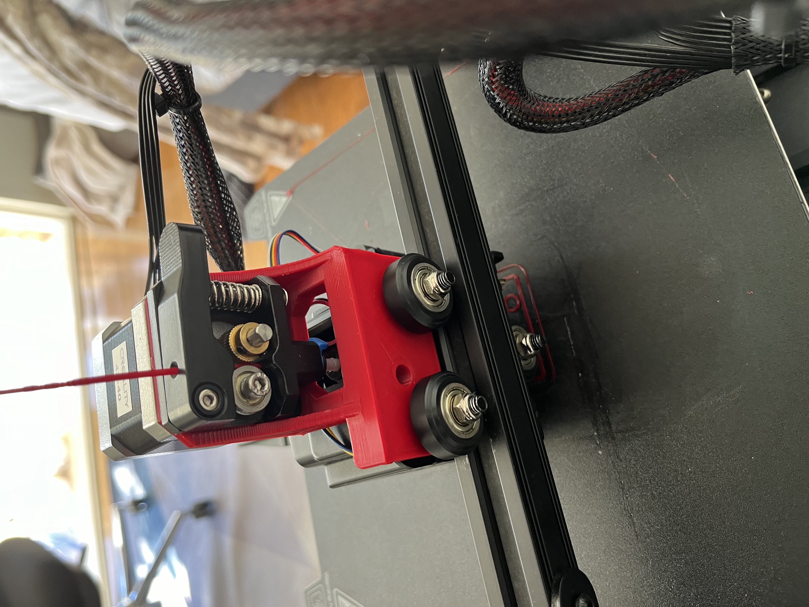
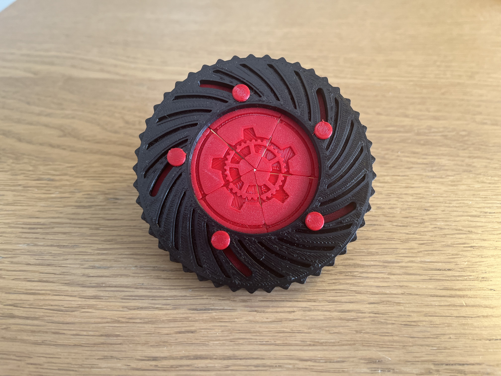
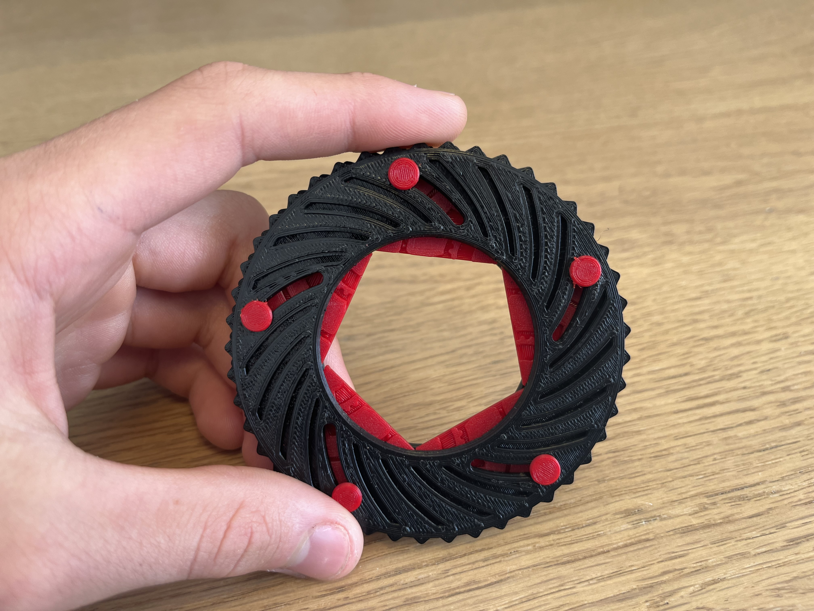
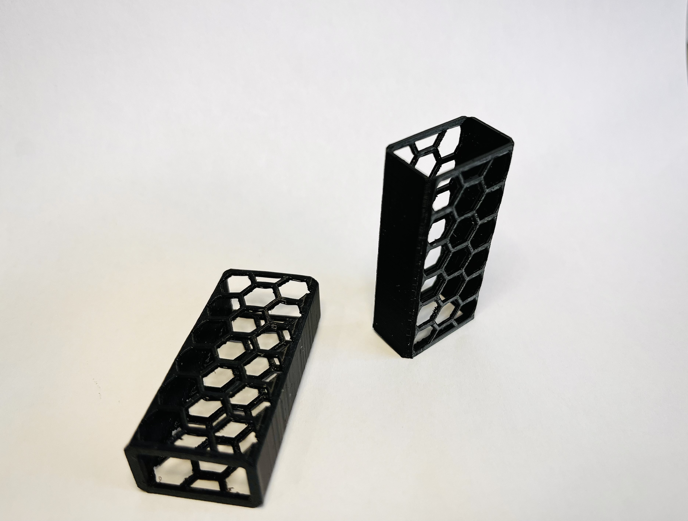
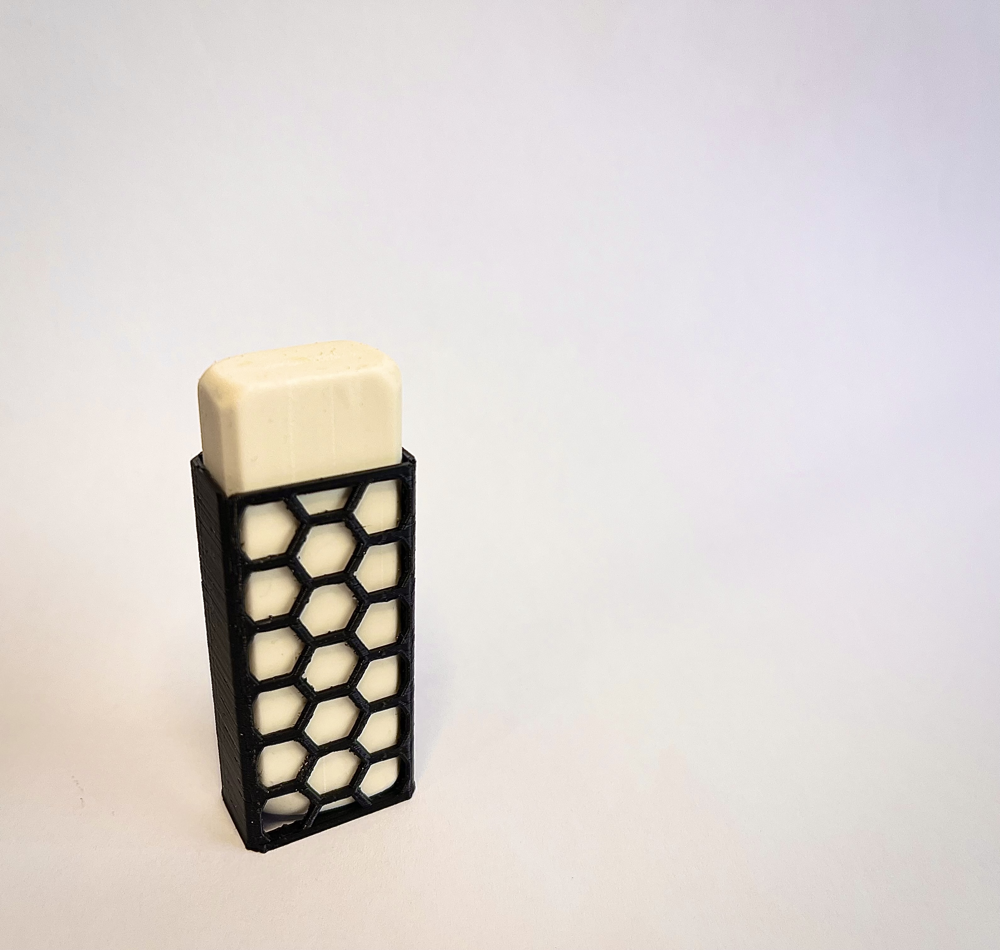
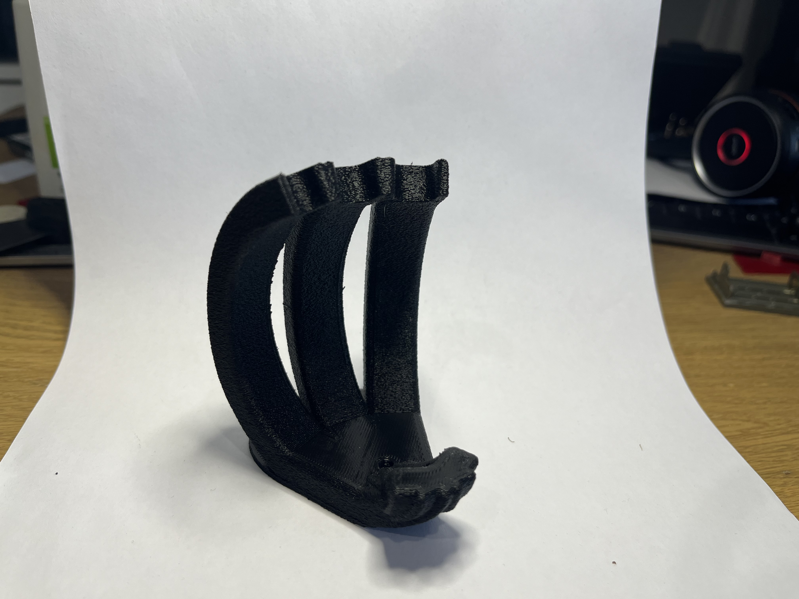
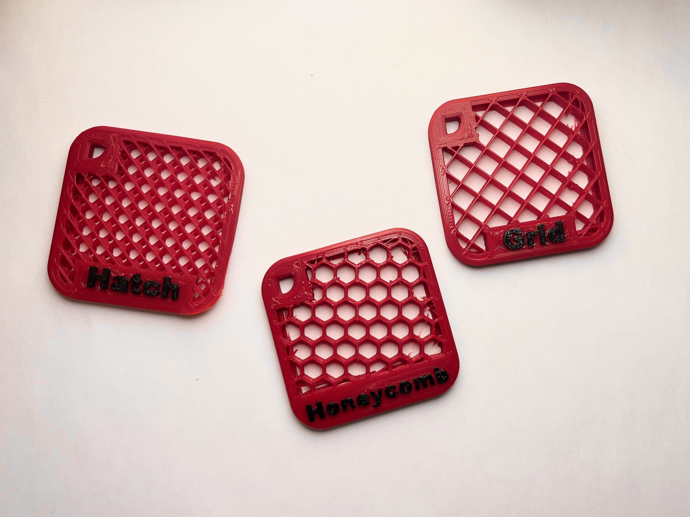
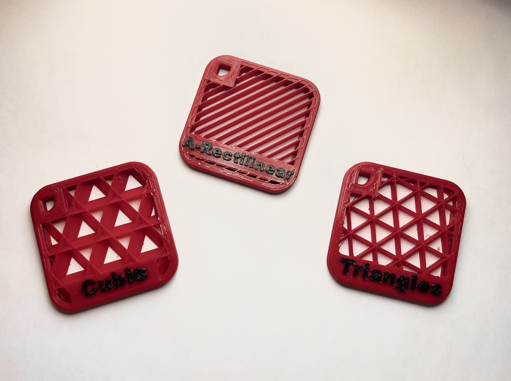
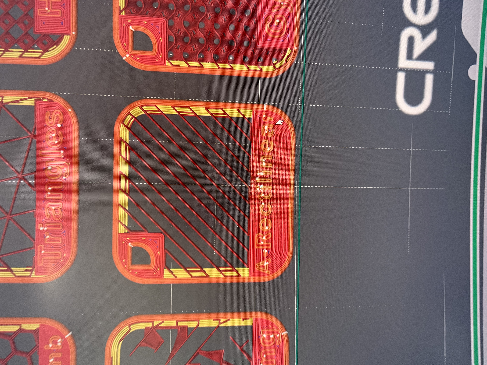

# 3D Design & Printing

## Printers

<video controls preload="none" poster="images/printing/ender3-mod-poster.jpg">
  <source src="images/printing/ender3-mod.mp4" type="video/mp4" />
</video>

An Ender 3 with a modified toolhead carriage.

## MakerWorld Models

I design my own 3D printable models and publish them on **MakerWorld**, where they can earn Maker Points - and payouts - based on downloads and prints by other users.

<video controls preload="none" poster="images/printing/bambu-iris-poster.jpg">
  <source src="images/printing/bambu-iris.mp4" type="video/mp4" />
</video>

**Iris** - a mechanical iris/aperture model.

### Infill Pattern Tests

A set of test prints comparing different slicer infill patterns - Cubic, A-Rectilinear, Triangles, Hatch, Honeycomb, Grid, and Chords - to see how each looks and behaves before choosing one for a published model.

[makerworld.com/en/@user_2952590735](https://makerworld.com/en/@user_2952590735)
