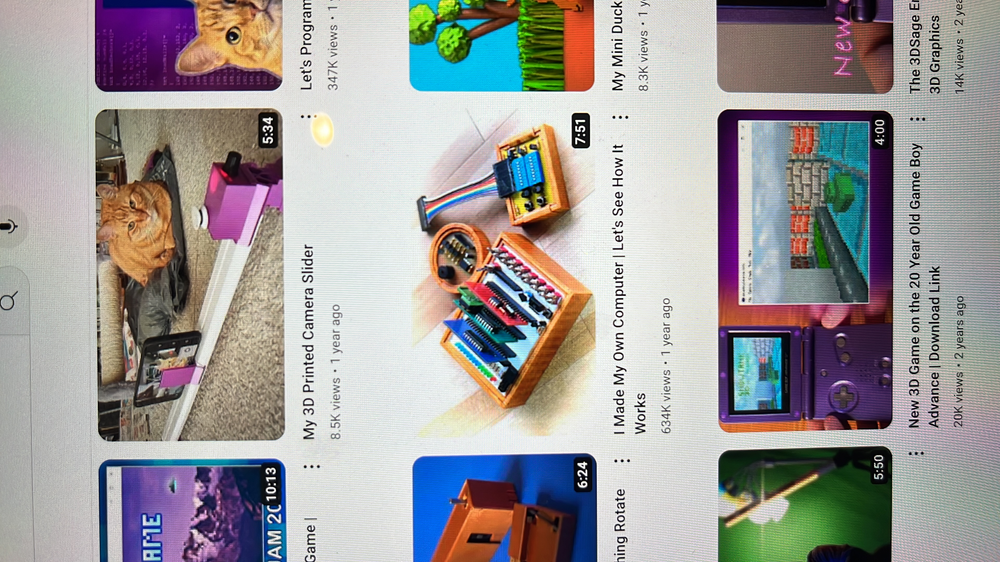
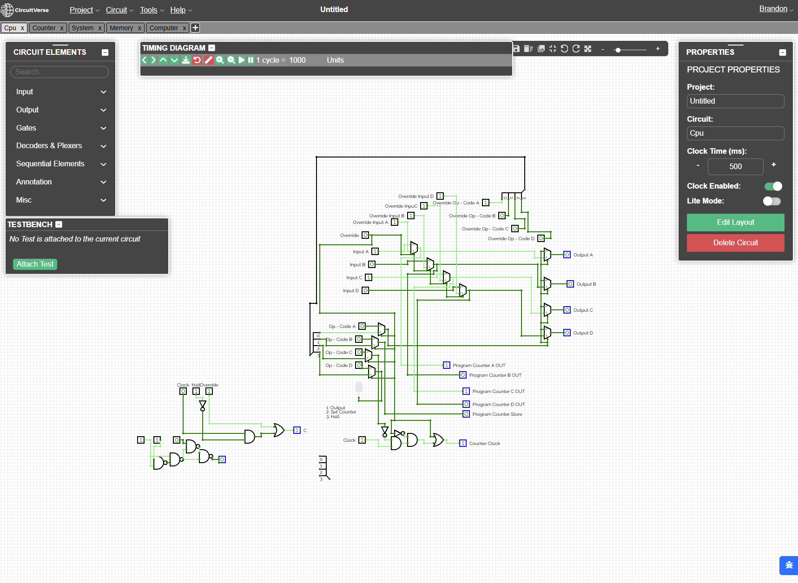
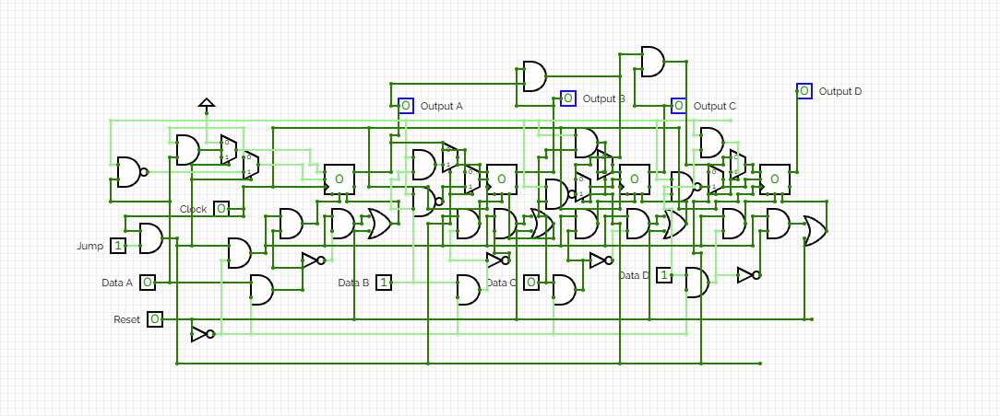
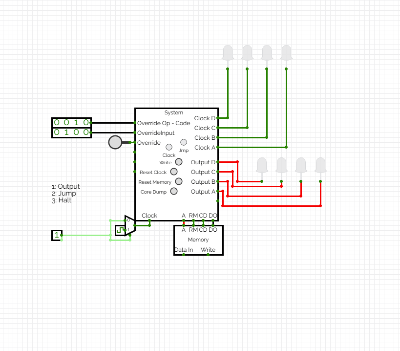
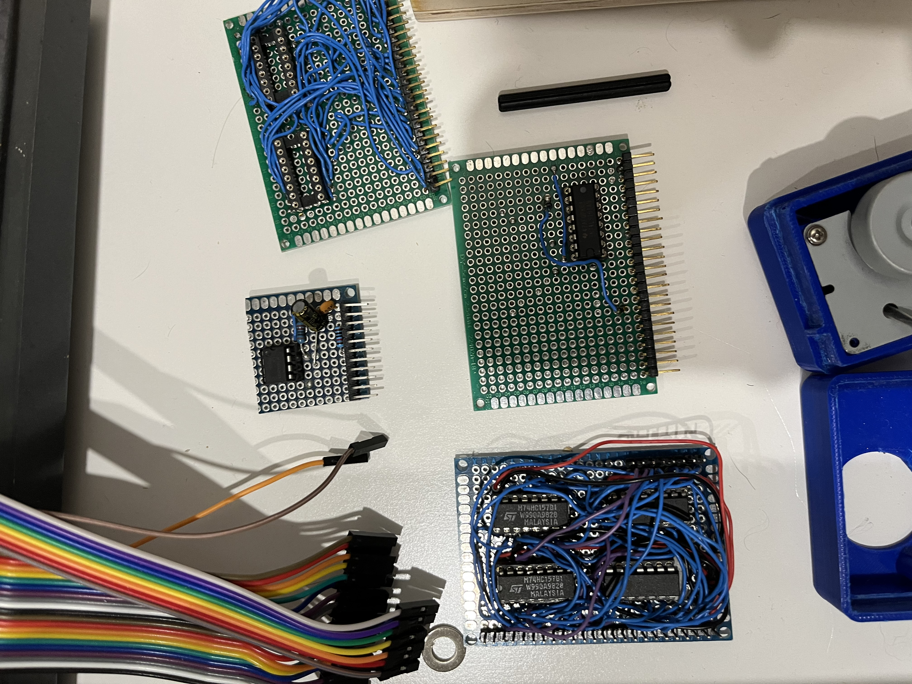
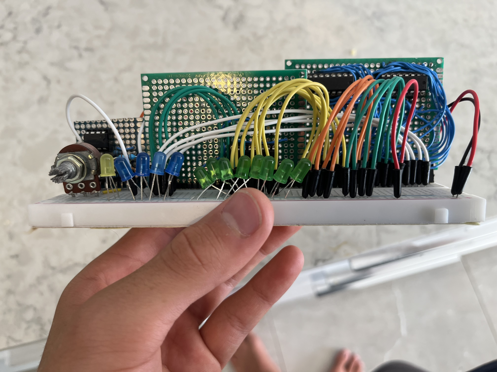
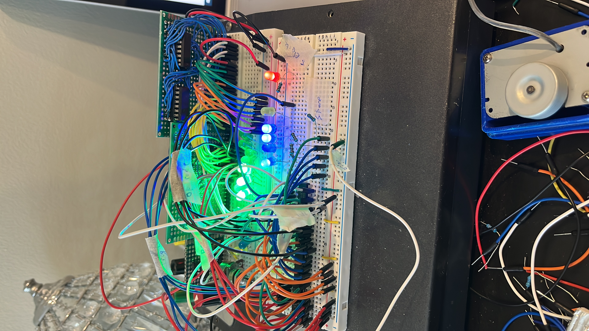
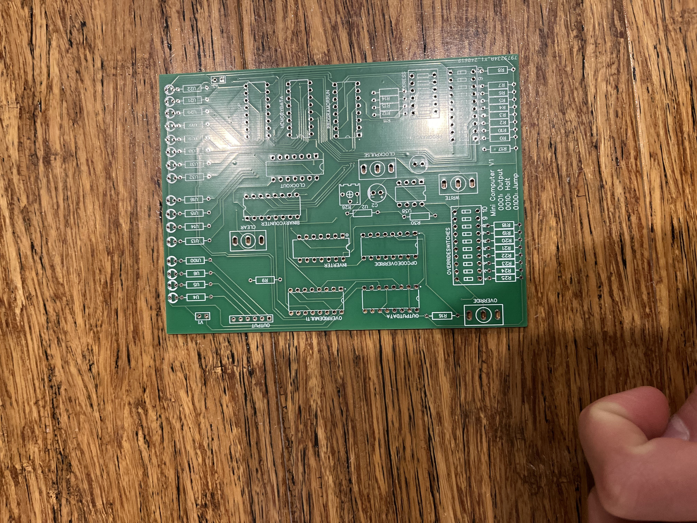
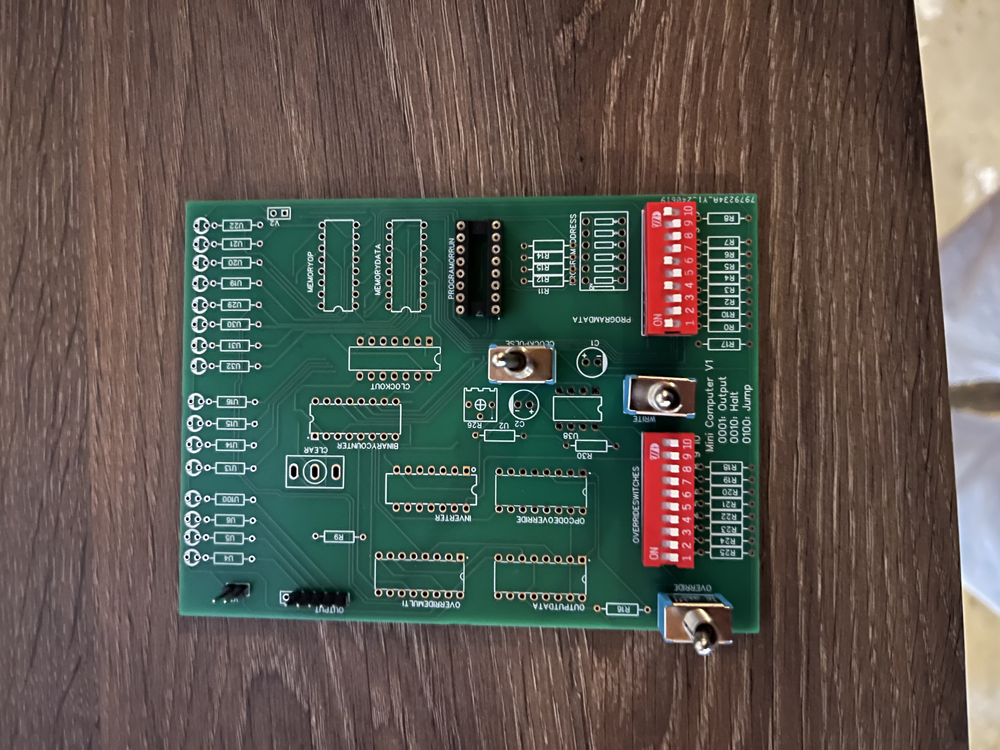

# Breadboard Computer

Inspired by 3D Sage's breadboard computer videos, I designed and built my own minimal-instruction-set computer from scratch, rather than following an existing build guide.

## Circuit Design (CircuitVerse)

Before touching any real hardware, I designed and simulated the whole computer logic-gate by logic-gate in CircuitVerse. The design is split into four main chips:

- **CPU** - decodes op-codes and routes data between inputs, outputs, and the program counter.
- **Counter** - the program counter, tracking which instruction is currently executing.
- **Memory** - a small RAM block that stores the program.
- **System** - wires the CPU, Counter, and Memory together into the full computer, plus a clock and manual override switches for debugging.

The CPU chip: input/output routing gates on the left and right, with override lines running through the middle so the whole computer can be manually driven for debugging.

The program counter chip, which increments each clock cycle or jumps to a new instruction address when told to.

The full system: CPU, Counter, and 16-bit RAM wired together, driven by a shared clock. The instruction set is deliberately minimal:

1. **Output** - push the current value to the output LEDs.
2. **Set Counter** - jump to a given instruction address.
3. **Halt** - stop the clock.

## Physical Build

Once the CircuitVerse design was working, I moved to real hardware: six hand-soldered perfboard cards (one per chip, plus supporting logic), designed to slot together rather than being wired as one big tangle.

<video controls preload="none" poster="images/custom-computer/clock-test-poster.jpg">
  <source src="images/custom-computer/clock-test.mp4" type="video/mp4" />
</video>

Testing the clock circuit: a 555 timer in astable mode generates the square wave that drives the whole computer's clock signal.

<video controls preload="none" poster="images/custom-computer/counter-test-poster.jpg">
  <source src="images/custom-computer/counter-test.mp4" type="video/mp4" />
</video>

Testing the 4-bit counter card on its own breadboard before integrating it with the rest of the system.

All six cards slotted together into the finished breadboard computer.

Powered on: the output LEDs lighting up as the computer runs.

<video controls preload="none" poster="images/custom-computer/instruction-demo-poster.jpg">
  <source src="images/custom-computer/instruction-demo.mp4" type="video/mp4" />
</video>

The finished computer executing a program: stepping through instructions and outputting values, driven entirely by hand-built logic gates rather than a microcontroller.

## Custom PCB (V1)

Having proven the design on breadboards, I moved the whole computer onto a custom PCB - Mini Computer V1 - to improve reliability over the hand-soldered perfboard-and-breadboard build.

The board keeps the same logical structure as the breadboard version - memory, program counter, clock, inverter, and override switches for manual debugging - now laid out as a single populated board instead of six separate cards.
