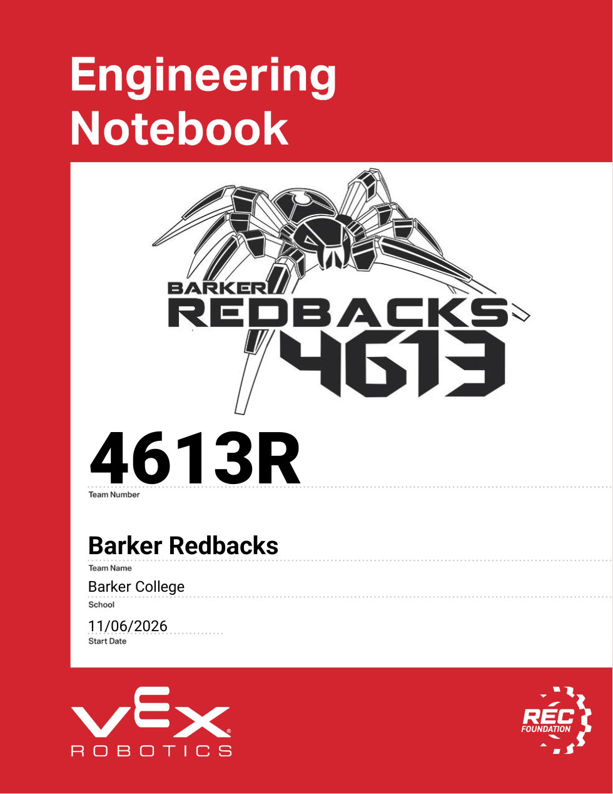
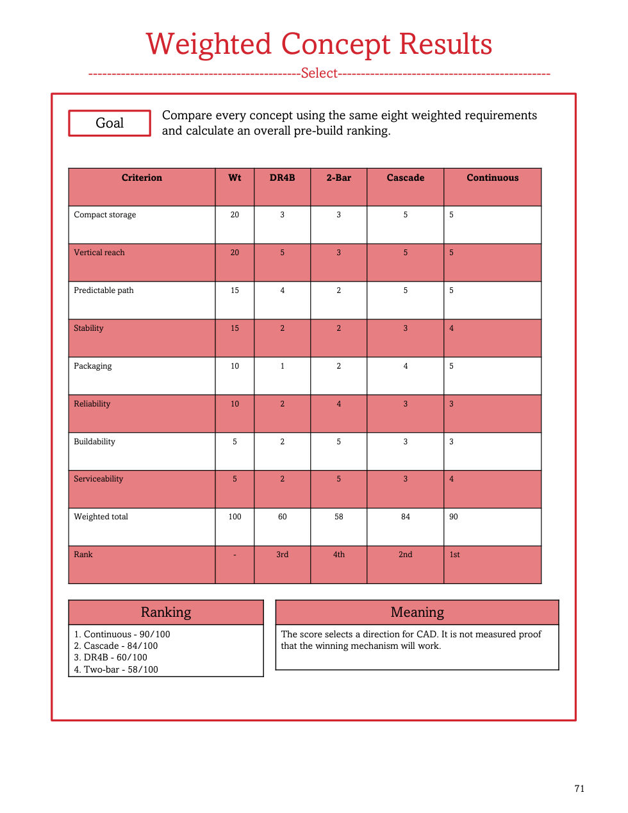
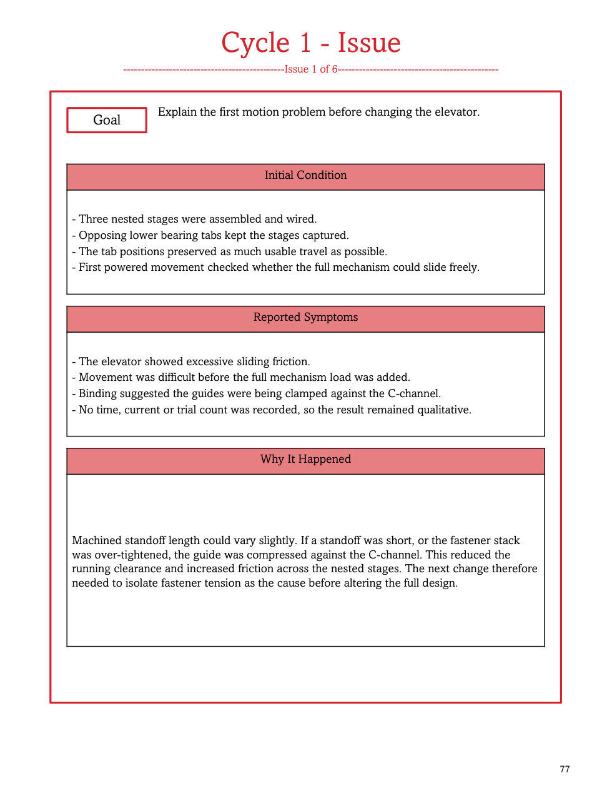
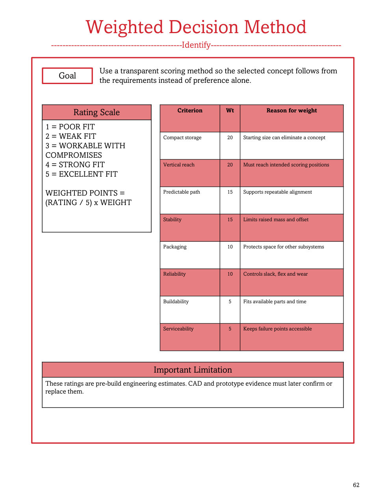

The 4613R engineering notebook for the V5RC *Override* season: **190 pages** following the full design cycle of Identify, Brainstorm, Select, Build, Test and Evaluate. It was produced with an AI-assisted workflow: a system that keeps rules, team memory and the judging rubric in files, drafts pages from the team's own reports, and runs a review loop against the rubric before anything is added to the deck.

## How the notebook is structured

- **Identify:** season goals, the challenge, field components, scoring opportunities, constraints, robot goals and drivetrain goals.
- **Brainstorm:** five robot designs and four claw designs, each with a sketch page and an analysis page, plus 4-wheel tank, 6-wheel tank and X-drive comparisons.
- **Select:** criteria, a weighted decision method, and written reasoning for the design, wheels and gearing.
- **Build and test:** six elevator build cycles, then claw improvements, robot constraints, and competition results (Shore, UNSW, Knox).

## Choosing the elevator with a weighted matrix

Four lift concepts were scored against the same eight weighted requirements, with compact storage and vertical reach weighted highest.

| Concept | Weighted score |
|---|---|
| Continuous elevator | 90 / 100 |
| Cascade elevator | 84 / 100 |
| Double reverse four-bar (DR4B) | 60 / 100 |
| Two-bar arm | 58 / 100 |

The notebook is explicit about what the score means: it picks a direction for CAD, it is **not** measured proof that the winner works. That is why the next section exists.

## Six elevator build cycles

Each cycle gets a divider, an "issue" page and a "what we needed to learn" page, each with one large photo and three short panels.

1. **Three-stage CAD and first friction:** the first powered three-stage test.
2. **Clearance fix and positive return:** fastener adjustment and a descent retest.
3. **Twin-string loaded failure:** two retraction strings failed under load.
4. **Two-stage rebuild:** simplified from three stages to two.
5. **Continuous retraction rope:** a continuous rope loop for retraction.
6. **Spacers, standoffs and spools:** manufactured parts to fix guide contact.

## Other design changes recorded

- **Intake transfer:** moved the end effector closer to the intake and added polycarbonate edge guides and ramps. The kicker roller runs at about 2× the intake speed because its smaller diameter gave a lower surface speed at the same RPM.
- **Lift assist:** rubber bands take load off the lift motors on the way up.
- **Toggles:** a piston-and-lever side toggle, and a back toggle triggered by a long standoff as the lift rises, with no extra actuator.
- **End effector:** piston claw (too large, needed manual alignment), then a powered claw (fit better but bulky), then a **vertical roller design** that pulls the game piece in from both sides.

## A note on the evidence

The six-cycle dates (6, 8, 11, 13, 17 and 20 August 2026) were reconstructed for notebook chronology and are not independently timestamped workshop records. Numbers were never invented where none were measured, and the notebook says so.

**Related:** the autonomous localization code behind the robot is on the [Redbacks Localization](redbacks-localization.html) page.
