Moving from VEX to FRC meant going from one robot to a whole engineering organisation. In the 2025-26 REBUILT season I worked on three robots across two Barker teams: **8613 Greybacks** and **4613 Redbacks**.

**My role**

* Mechanical designer and drive-team technician on both teams.
* Design lead and team captain for 8613 at Worlds.
* Designed intakes, the ball hopper and the Level 3 climber prototype.

<ul class="glance"><li><b>2</b>Division titles</li><li><b>Einstein</b>8613 reached the Einstein field</li><li><b>1</b>Regional title</li><li><b>2</b>Awards</li></ul>

# Southern Cross Regional

8613 Greybacks ranked **8th of 42**, went 12-3, and was the 1st pick of the #1 alliance. The alliance won all five playoff matches recorded. **Regional Champions and Industrial Design Award.**

My work: the scoring mechanism CAD and the **Level 3 climber**, the hardest endgame climb.

<figure>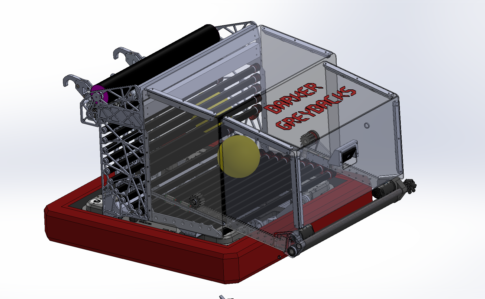<figcaption>Scoring mechanism in CAD</figcaption></figure><figure>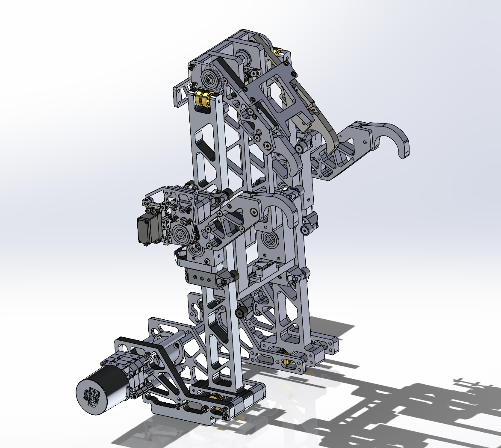<figcaption>Level 3 climber in CAD</figcaption></figure><figure>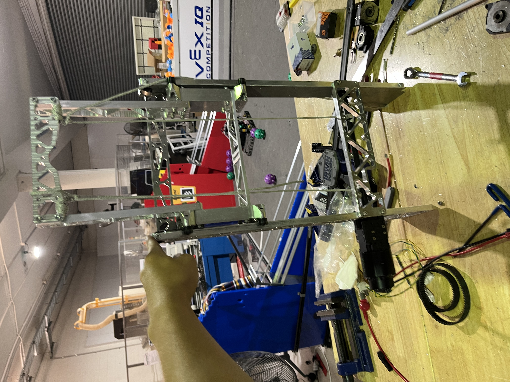<figcaption>Climber prototype</figcaption></figure>

<figure>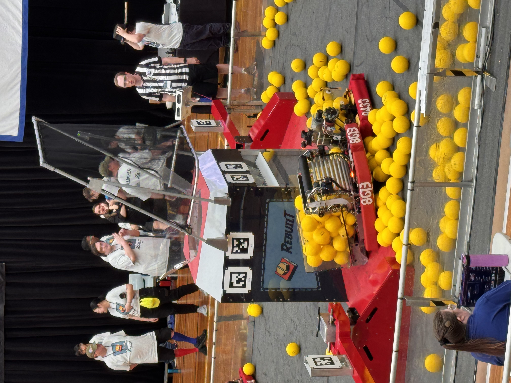<figcaption>8613 in action at the regional</figcaption></figure><figure>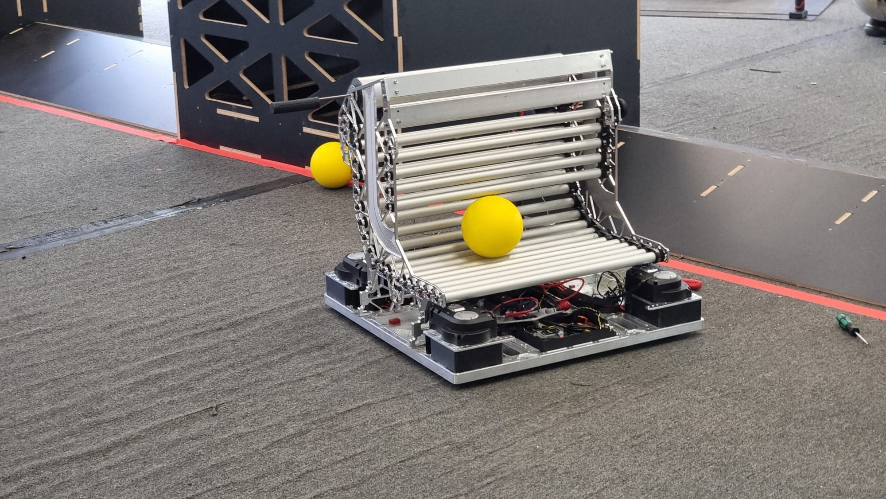<figcaption>Scoring</figcaption></figure><figure>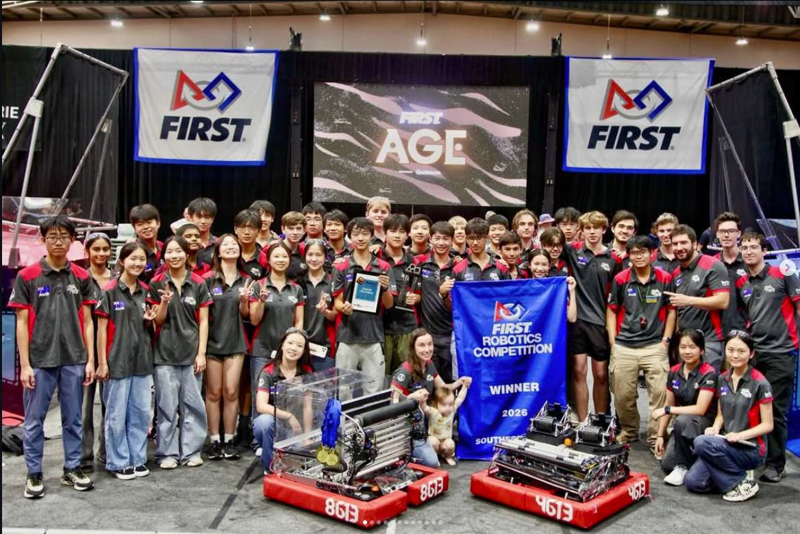<figcaption>8613 and 4613 with the winner banner</figcaption></figure>

# FIRST Championship - Houston

8613 ranked 17th of 74 (10-4), was picked 2nd by the #2 alliance, and **won the Curie Division**. I was team captain and design lead, and I designed the intake.

<figure>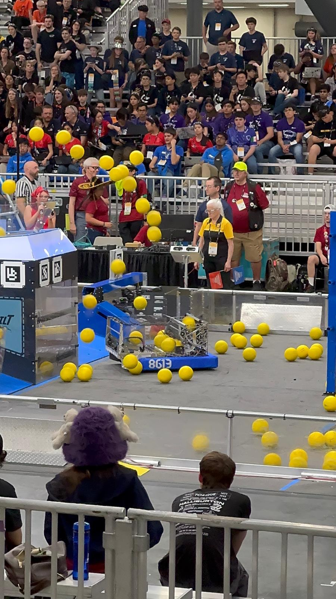<figcaption>The Greybacks robot mechanism</figcaption></figure><figure>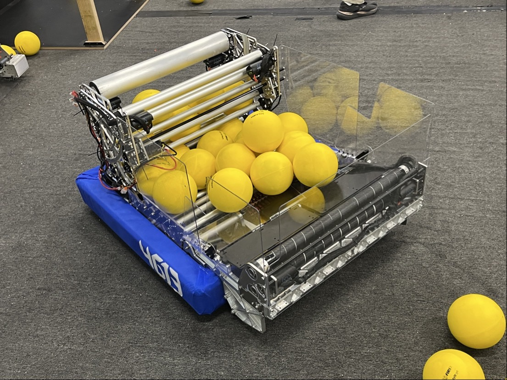<figcaption>Mechanism CAD</figcaption></figure><figure>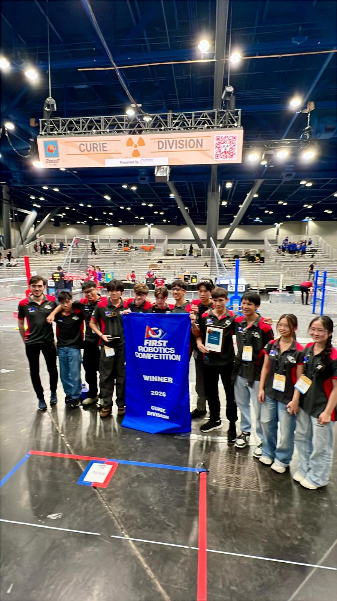<figcaption>Division winner banner</figcaption></figure>

# FIRST Championship - 4613 Barker Redbacks

At Worlds I also helped build 4613. It ranked **42nd of 74** (5-5), then was picked 3rd by the #1 alliance and **won the Hopper Division**. 4613 also took the **Quality Award**. I designed the intake and the ball hopper.

<figure>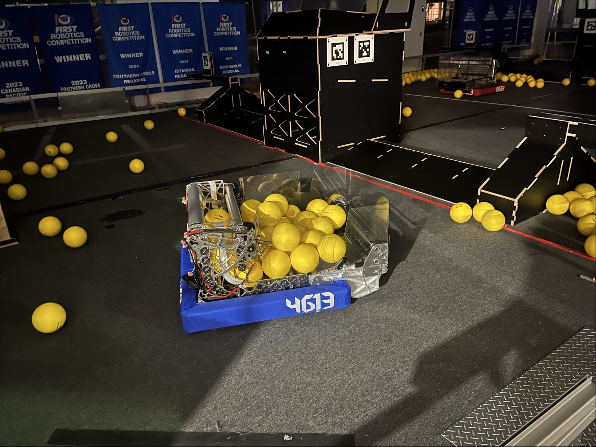<figcaption>4613 Redbacks robot</figcaption></figure><figure>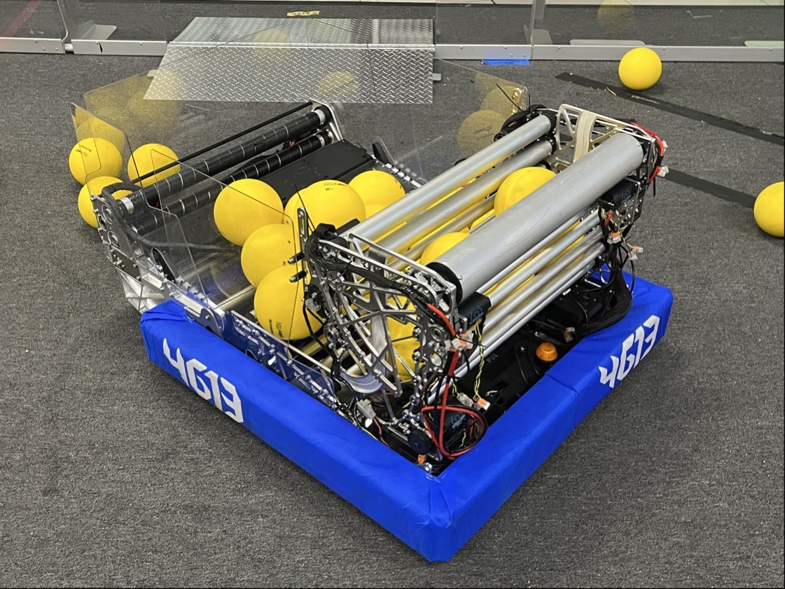<figcaption>Close-up</figcaption></figure><figure>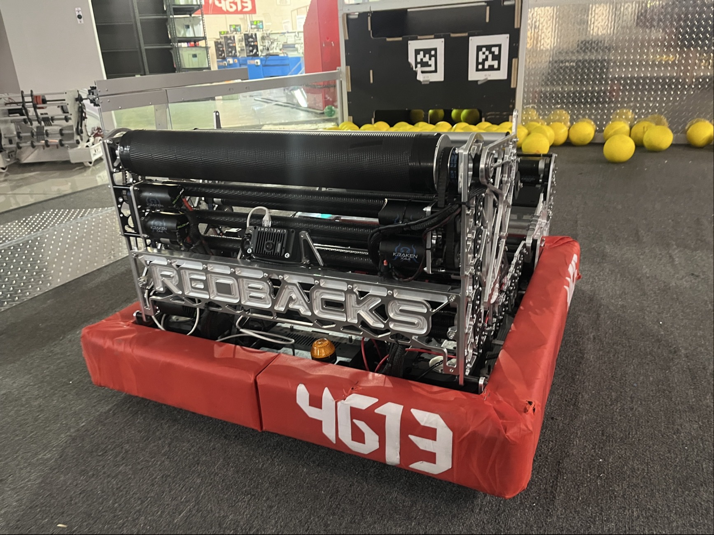<figcaption>Back view</figcaption></figure>

<figure>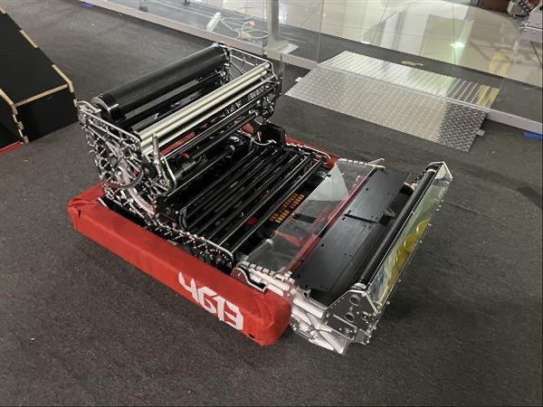<figcaption>A subsystem on the bench</figcaption></figure><figure>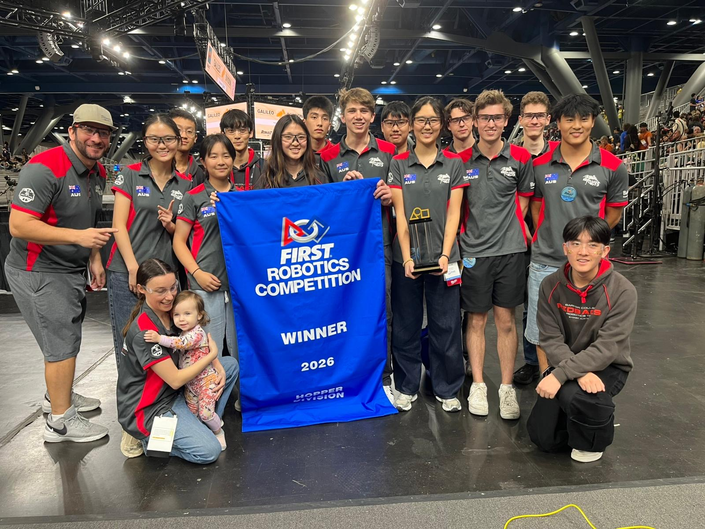<figcaption>The team with the winner banner</figcaption></figure>

# Einstein

Winning Curie sent 8613 to the **Einstein field**, up against the other division winners. The alliance went 2-2 and was eliminated in round 4, with close matches of 717-632 and 769-638 won and 627-713 and 699-720 lost.
