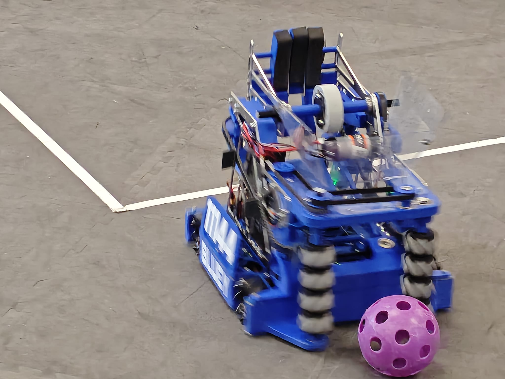
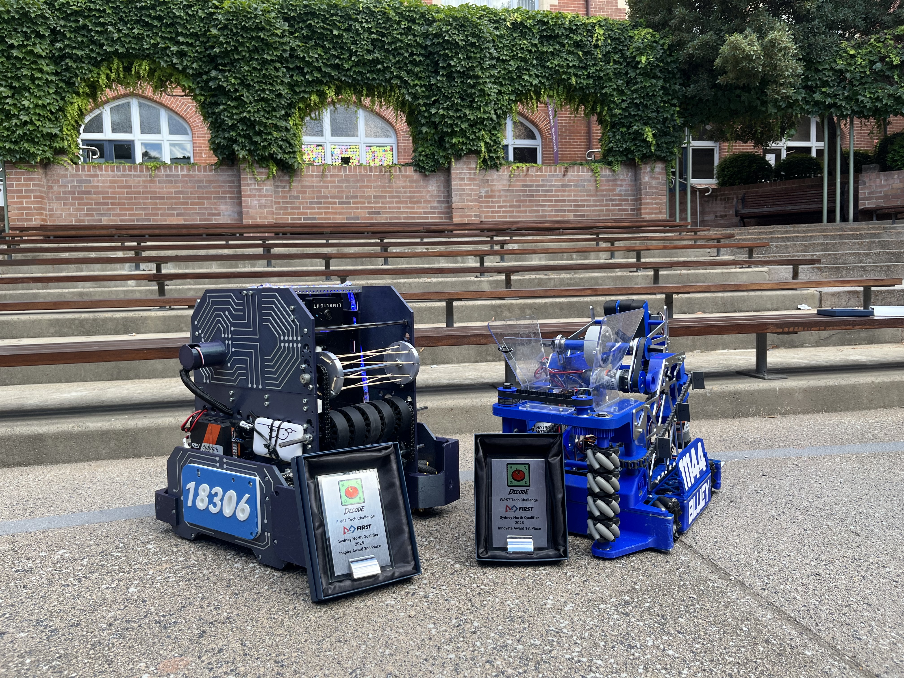
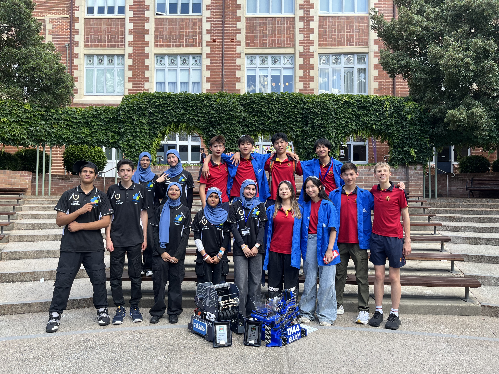

# FIRST Tech Challenge

At the **Sydney North Qualifier 2025**, in the DECODE game, our teams won two awards.

<ul class="glance"><li><b>1st</b>Innovate Award, Bluey (11144)</li><li><b>2nd</b>Inspire Award (18306)</li></ul>

<figure class="fig"><figcaption>Bluey, team 11144, on the field.</figcaption></figure>

<figure><figcaption>The robots with their award plaques</figcaption></figure><figure><figcaption>The team</figcaption></figure>

