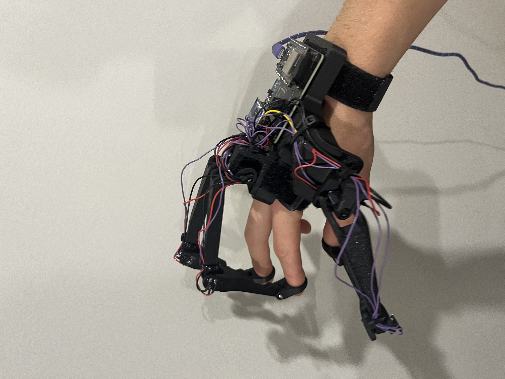
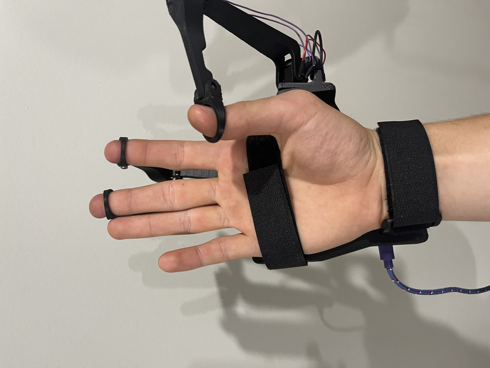
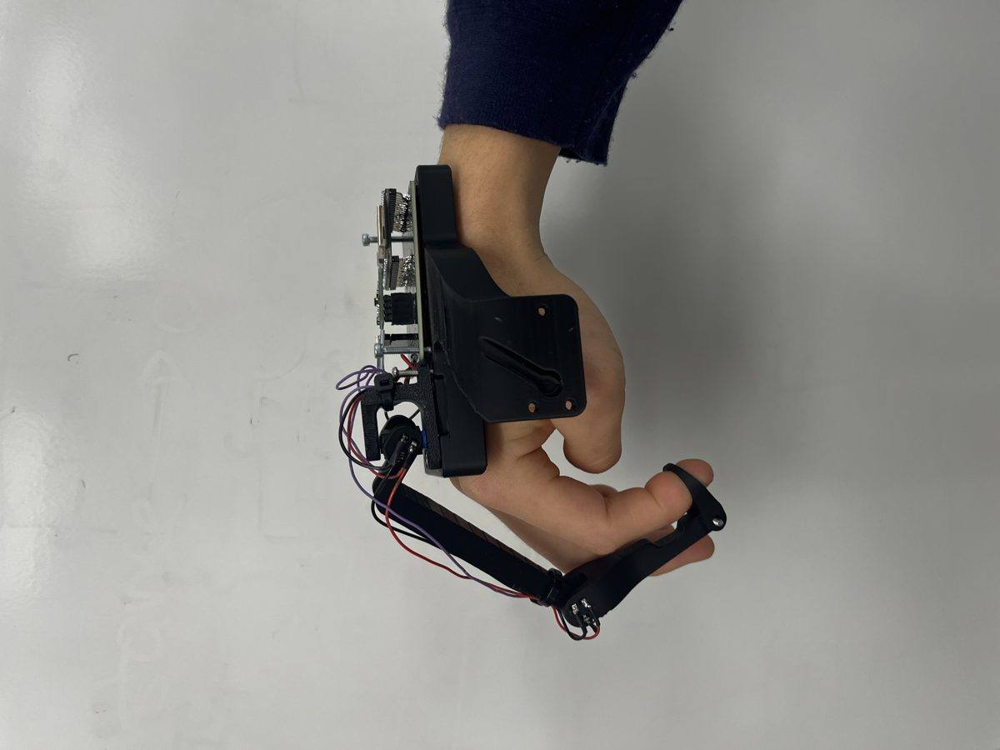
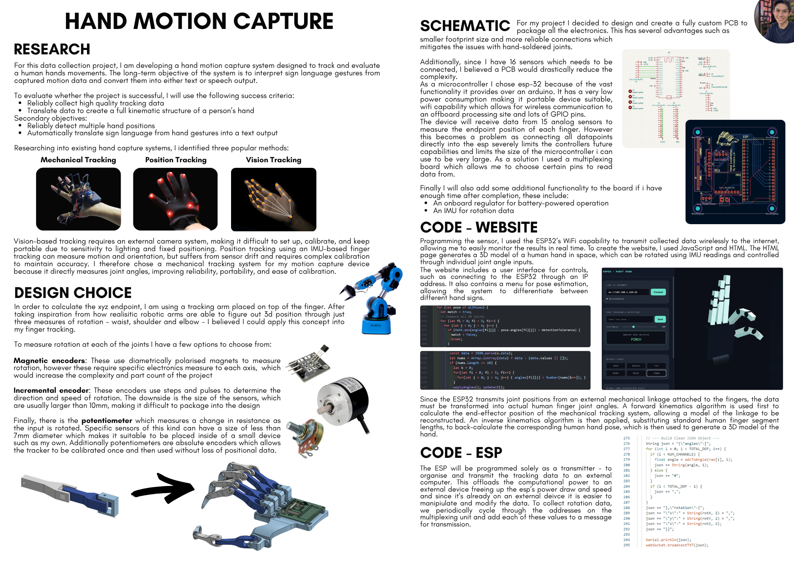
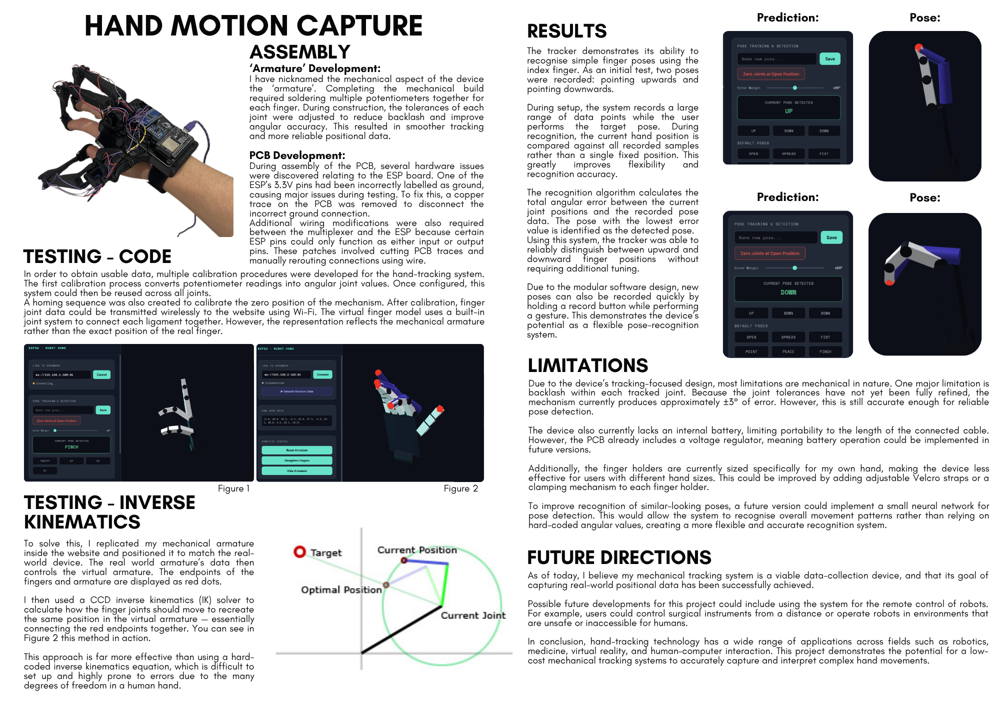

# Mechanical hand motion capture

A low-cost glove that measures finger joints directly with potentiometers, then rebuilds a live 3D hand. Built for sign-language interpretation.

**My role**

* Designed the mechanical linkage and the custom PCB.
* Wrote the firmware and the browser 3D model.
* Built calibration and the pose recognition.

<ul class="glance"><li><b>15</b>joint channels</li><li><b>ESP32</b>wireless to browser</li><li><b>+/- 3 deg</b>joint error</li><li><b>2 of 2</b>poses told apart</li></ul>

<figure><figcaption>The tracker worn on the hand</figcaption></figure><figure><figcaption>Another angle</figcaption></figure><figure><figcaption>Side view of the finger linkages</figcaption></figure>

## Why mechanical

I compared three ways to track a hand.

* **Camera:** needs a rig and good lighting.
* **IMU glove:** drifts, and needs constant recalibration.
* **Mechanical linkage:** measures the angle directly. No drift, simple calibration.

I chose the linkage. Sub-7 mm potentiometers fit inside the fingers and give an absolute reading.

## The electronics

* A custom PCB holds an ESP32 and multiplexers, so 15 sensors need very few pins.
* The ESP32 only reads sensors and sends the numbers over Wi-Fi. A computer does the maths.
* Two PCB faults were fixed by hand: a mislabelled supply pin, and pins that were input-only.

## From numbers to a hand

Two stages turn raw readings into a hand pose.

1. **Forward kinematics** turns the linkage angles into fingertip positions.
2. **Inverse kinematics** (CCD) finds the human finger angles that reach those points.

The browser draws the result live as a 3D hand.

## Calibration and testing

* **Angle calibration** converts resistance to degrees, once per joint type.
* **Homing** sets the zero position.
* **Test:** the tracker reliably told a finger pointing up from pointing down. New poses are added by holding a record button.

<figure><figcaption>Project poster, page 1</figcaption></figure><figure><figcaption>Project poster, page 2</figcaption></figure>

## Limits and next steps

* Joint backlash gives about 3 degrees of error.
* No battery yet, and it only fits my hand.
* Next: a small neural network to recognise movements, then sign-to-text.
