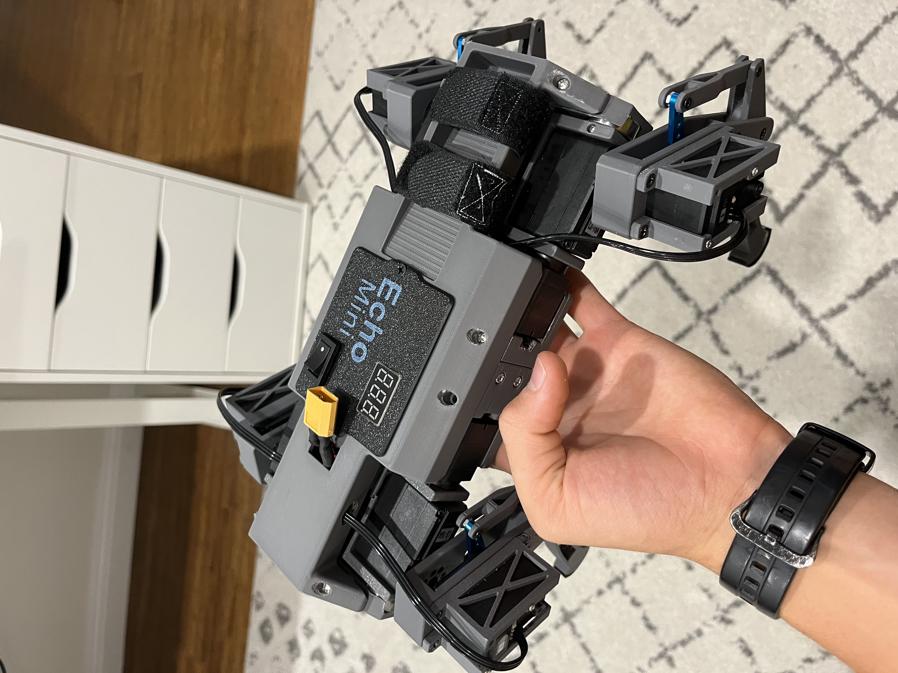
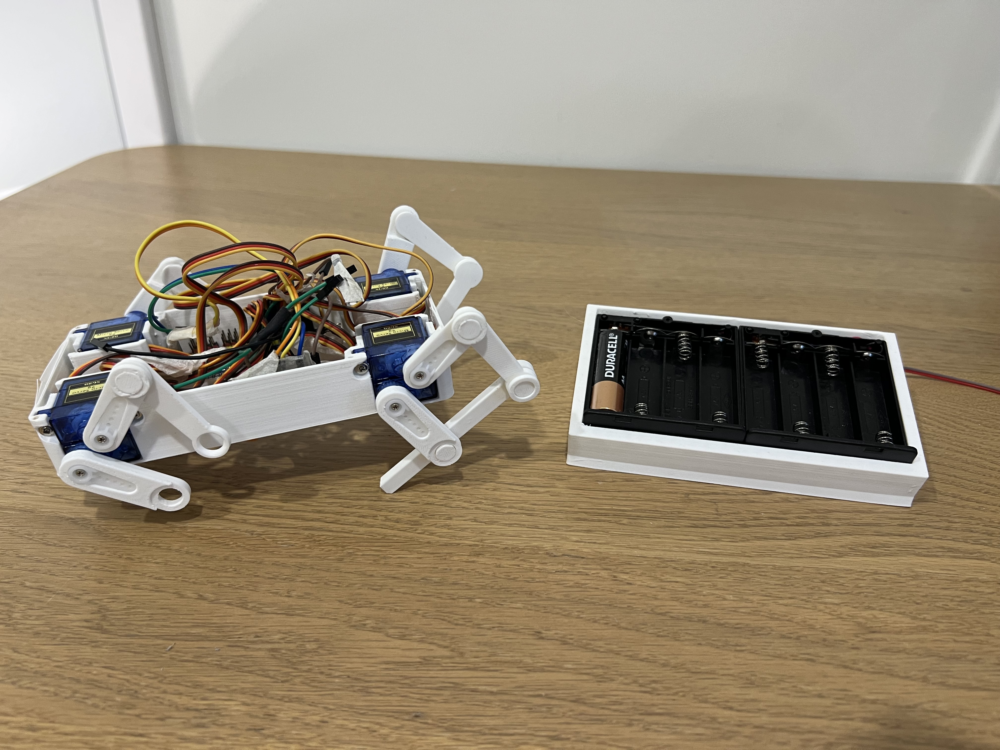
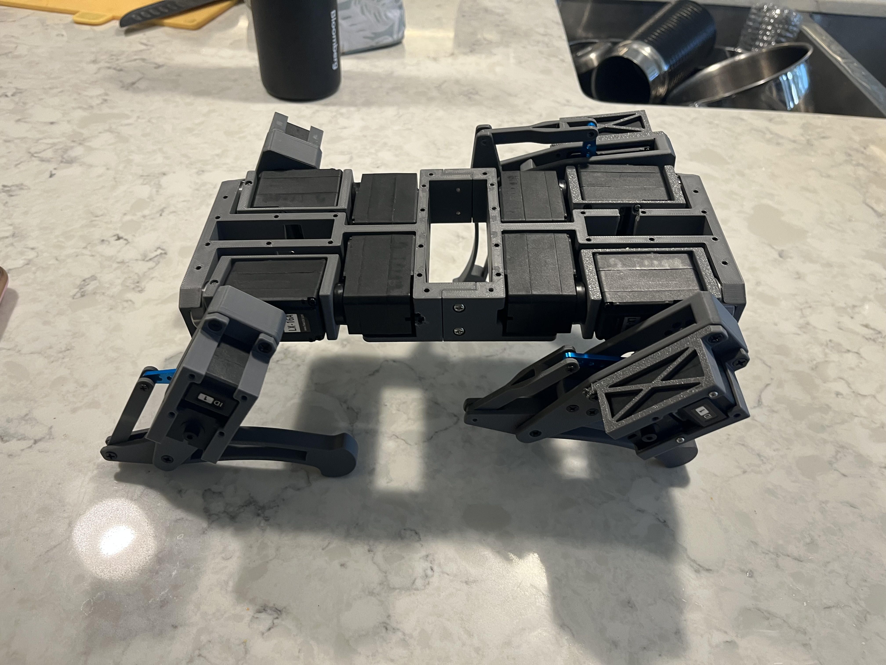
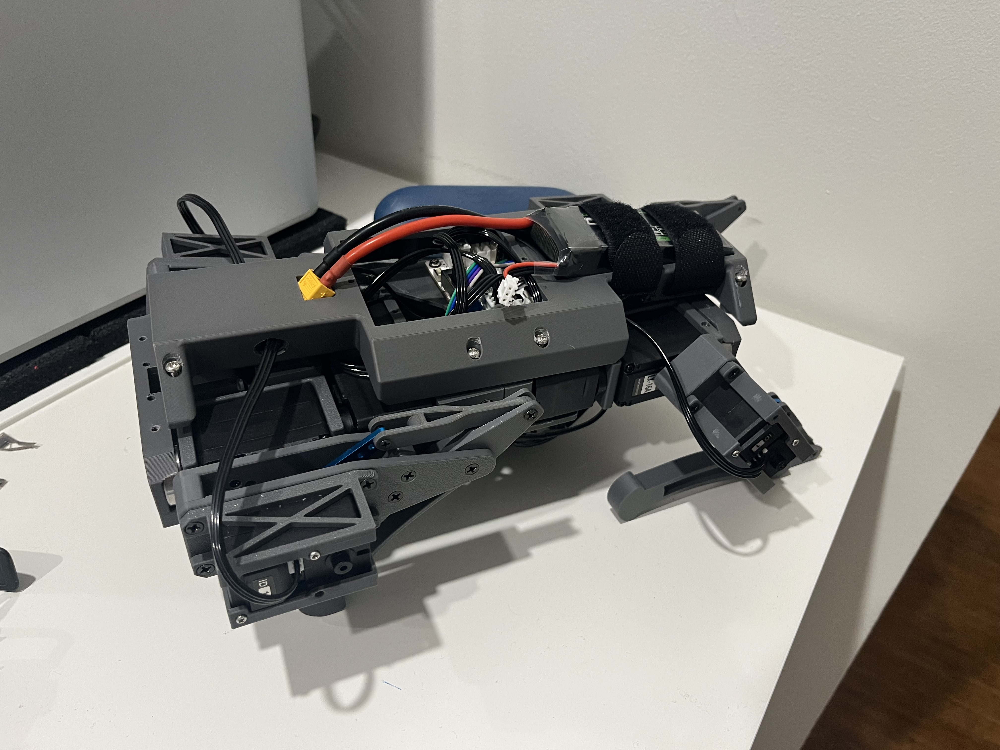

A small quadruped robot that walks around my house. It had to be compact, light and cheap. I built three prototypes, and each failure became the next version's requirements.

**My role**

* Designed all of it: CAD, electronics and code.
* Taught myself inverse kinematics to make it walk.

<ul class="glance"><li><b>3</b>prototypes</li><li><b>3D printed</b>every version</li><li><b>Li-ion</b>final power</li><li><b>IK</b>walking gait</li></ul>

<figure class="fig"><figcaption>Mini Echo, the final integrated version.</figcaption></figure>

# Version 1 — Prototyping the Concept

Micro servos and an AA battery pack. The goal was to find out if it could walk at all.

* The servos were too weak.
* The batteries could not supply enough current.
* **Lesson:** a robot is only as good as its weakest part.

<figure class="fig"><figcaption>Version 1 with micro servos and the AA pack.</figcaption></figure>

# Version 2 — Servos, Inverse Kinematics and Walking

Stronger bus servos, daisy-chained to simplify the wiring.

* I taught myself the trigonometry of **inverse kinematics**: choose where a foot goes, and the maths finds the joint angles.
* I used that to build walking gaits.
* It worked, but the legs were too heavy.

# Version 3 — Mechanical Optimisation

I moved the actuators up into the body and used linkages to drive the legs. Light legs mean faster, more efficient movement. A lithium-ion battery replaced the AAs.

<figure class="fig"><figcaption>The bare Version 3 frame, with servos high in the body and linkages to the legs.</figcaption></figure>

# Mini Echo: the integrated robot

Everything came together in one robot:

* Light 3D-printed structure and high-mounted actuators.
* Lithium-ion power with voltage monitoring and a power button.
* A display, and wireless controller driving.
* Inverse-kinematics leg control and tuned gaits.

<figure class="fig"><figcaption>Mini Echo from another angle.</figcaption></figure>

# What I learned

Mechanics, electronics and software all affect each other. The first version showed weak power ruins good hardware. The second showed that maths can replace trial and error. The third showed that moving mass out of the legs matters most. Every limit became a requirement for the next prototype.
