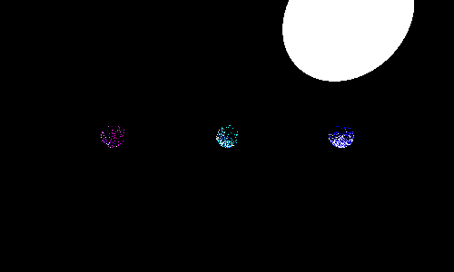
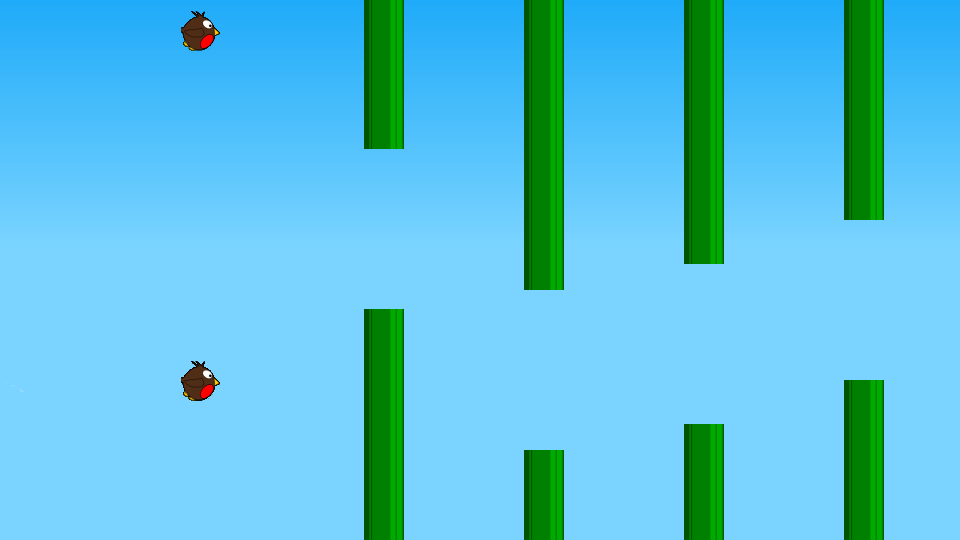
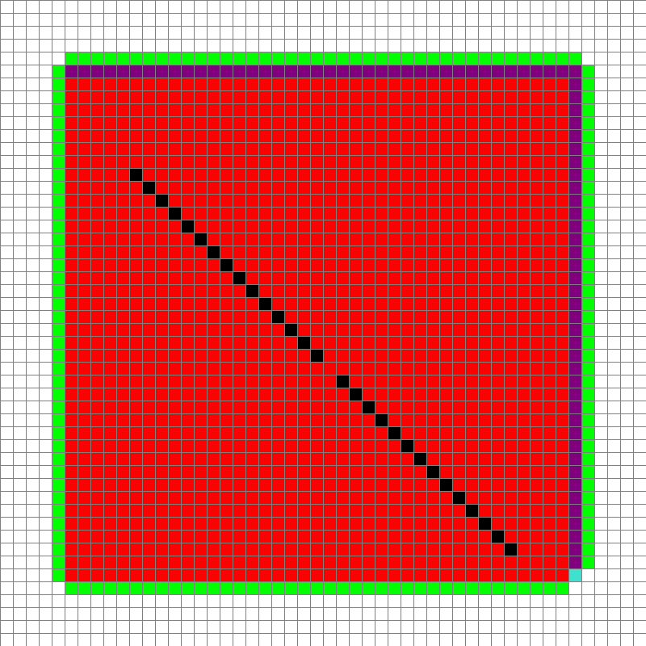
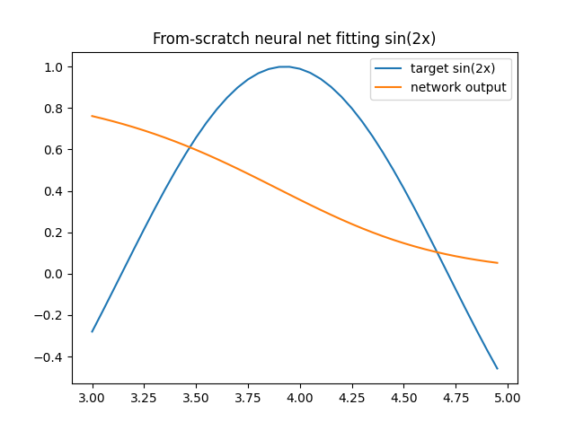

# Python projects

Small programs I wrote from scratch to understand how algorithms really work. I wrote them before using AI tools.

<ul class="glance"><li><b>6</b>projects</li><li><b>0</b>ML frameworks used</li><li><b>3</b>videos</li></ul>

## Path tracer

A CPU path tracer written from first principles: ray-sphere hits, diffuse bounces, 8 bounces and 150 samples per pixel.

<figure class="fig"><figcaption>Three spheres and a light, rendered by my own tracer.</figcaption></figure>

## Flappy Bird learns to fly

A NEAT-style network evolves over generations. Each bird has its own small brain, and the best survive.

<figure><figcaption>Mid-flight, a whole generation at once</figcaption></figure>

<figure><video controls preload="none" poster="images/python-projects/flappy-bird-best-poster.jpg"><source src="images/python-projects/flappy-bird-best.mp4" type="video/mp4" /></video><figcaption>The best bird from a later generation</figcaption></figure>

## A* pathfinder

Place a start, an end and walls with the mouse, then watch A* search the grid. Red cells are visited. The path is the result.

<figure class="fig"><figcaption>A* search with explored cells and the final path.</figcaption></figure>

## Neural network from scratch

Only `numpy`, no framework. It learns a sine curve using finite-difference gradient descent.

<figure class="fig"><figcaption>The network's curve closing in on a sine wave.</figcaption></figure>

## MazeRush

A two-player first-person maze race in Small Basic, for a Year 9 assignment. Mazes come from a depth-first backtracker. Walls are drawn by ray marching, 70 rays across 90 degrees.

<figure><video controls preload="none" poster="images/python-projects/maze-generation-poster.jpg"><source src="images/python-projects/maze-generation.mp4" type="video/mp4" /></video><figcaption>Maze generation</figcaption></figure><figure><video controls preload="none" poster="images/python-projects/maze-rush-gameplay-poster.jpg"><source src="images/python-projects/maze-rush-gameplay.mp4" type="video/mp4" /></video><figcaption>Gameplay</figcaption></figure>

## Also built

* Tic-tac-toe AIs: two minimax versions and a neural network.
* A wave function collapse prototype.
* A VEX IQ score calculator.
