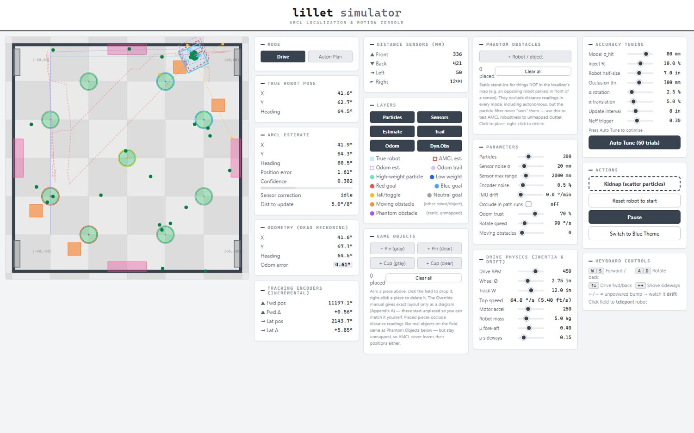
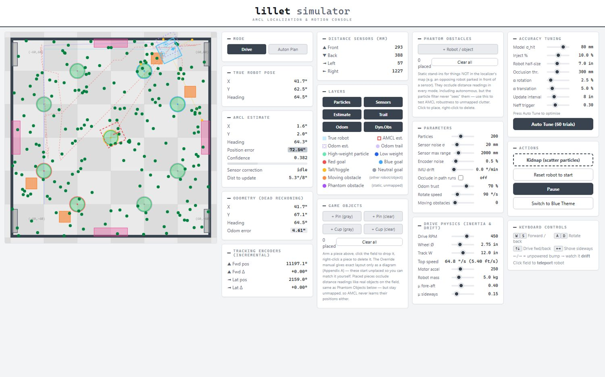
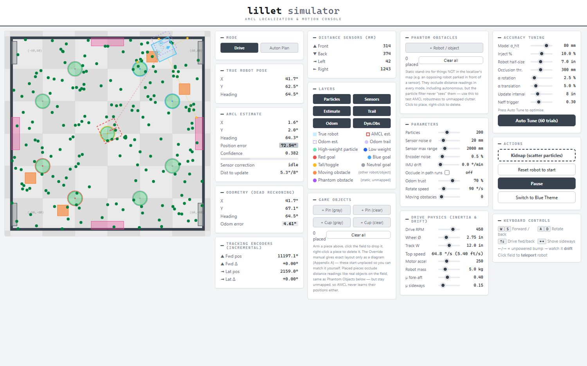
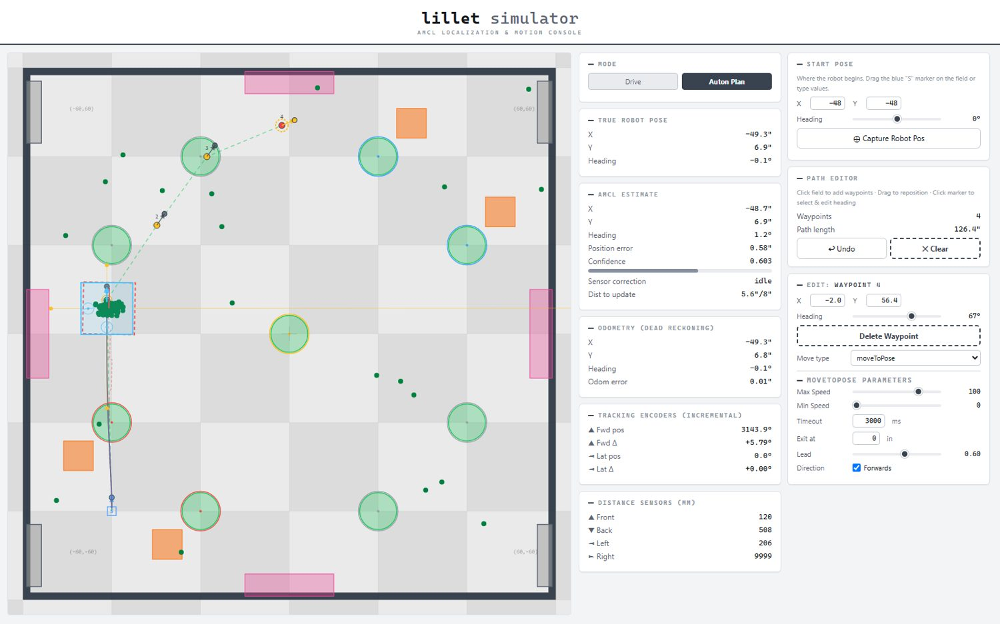

# Redbacks localization

VEX robots have no GPS, and wheel encoders drift. **lillet** is the C++ library I wrote so our robot always knows where it is.

**My role**

* Wrote the whole library: odometry, particle filter, motion controller.
* Built the browser simulator and the docs site.
* Wired it into the robot's code.

<ul class="glance"><li><b>200</b>pose guesses tracked</li><li><b>20</b>simulator tests passing</li><li><b>0.22 in</b>mean error in simulation</li><li><b>40 ms</b>localisation loop</li></ul>

* [lillet library docs](https://beel487.github.io/lillet/docs.html)
* [AMCL localisation simulator](https://beel487.github.io/lillet/Sim.html)

## How it works

Three layers, each fixing the last one's weakness.

* **Odometry:** a tracking wheel and IMU. Fast, but it drifts.
* **Distance sensors:** four sensors read the field walls. Accurate, but noisy.
* **Particle filter:** keeps 200 guesses of the robot's pose. Guesses that match the sensors survive. The rest die out.

## Watch it work

The simulator lets me test the filter before the robot moves.

<figure><figcaption>The green cloud of guesses has collapsed onto the robot</figcaption></figure><figure><figcaption>I pick the robot up and move it: the guesses scatter</figcaption></figure><figure><figcaption>Within a few updates the cloud finds it again</figcaption></figure>

## Driving with it

* **Motion controller:** the robot chases a point just ahead of itself, so paths curve smoothly. A locked-sign turn profile stops it spinning back and forth near 180 degrees.
* **Autonomous planner:** click waypoints in the simulator, then copy them out as robot code.

<figure class="fig"><figcaption>A planned autonomous path running in the simulator.</figcaption></figure>

## The code

<figure><figcaption>Scoring each guess against the sensor readings</figcaption></figure><figure><figcaption>Resampling and the final pose estimate</figcaption></figure>

**Source:** [github.com/BeEl487/Redbacks-optimal-vex-code](https://github.com/BeEl487/Redbacks-optimal-vex-code)
