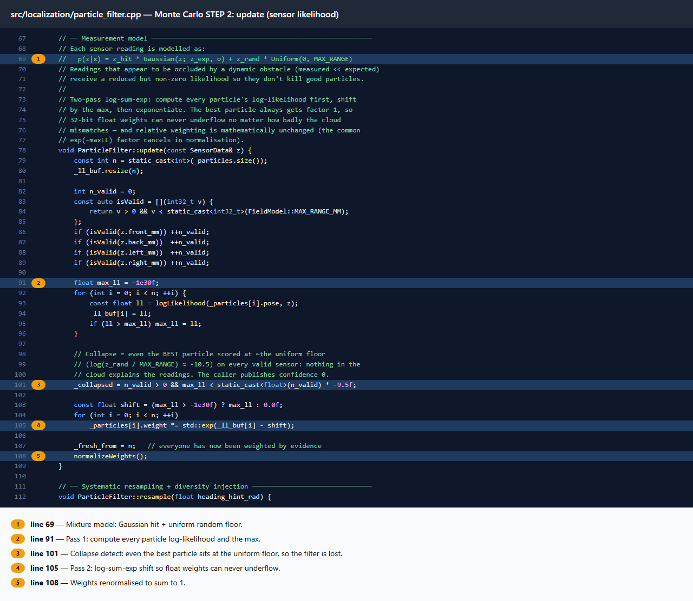
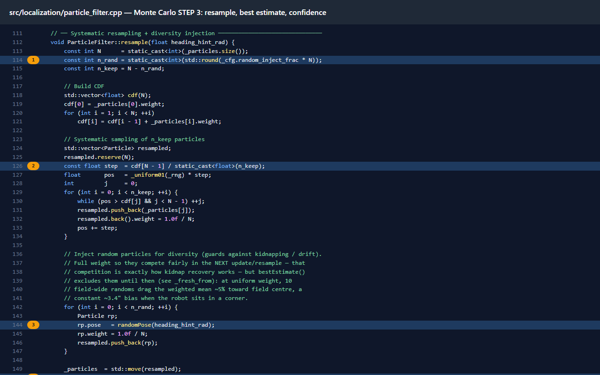

VEX robots have no GPS. In a 15-second autonomous period you still need to know where you are on a 144" × 144" field. Dead-reckoning from wheel encoders drifts, especially through turns and wheel slip, and one early error ruins every later move.

**lillet** is the custom C++ library I wrote for team 4613B's Override robot (PROS on the V5 Brain) to fix that. It is a full probabilistic localization stack plus a closed-loop motion controller.

## The stack

| Layer | What it does |
|---|---|
| **Odometry** | Tracking wheel plus IMU for heading. Fast and continuous, but drifts. |
| **Distance sensors** | Four sensors (front, back, left, right) give absolute readings off the field walls. Noisy, so used as corrections. |
| **AMCL particle filter** | Keeps 200 pose hypotheses at once and fuses odometry with the sensors, converging on the true position even from an uncertain start. |
| **Motion controller** | Boomerang-style carrot path following and a locked-sign turn profile, reading the fused pose every 10 ms. |

## Key ideas

- **Honest uncertainty.** A Thrun motion model spreads the particle cloud to match real odometry noise, instead of pretending the wheels are perfect.
- **Robust sensing.** A hybrid Gaussian + uniform likelihood, plus an occlusion gate, stops another robot driving past a sensor from destroying the filter.
- **Ray casting.** Each particle computes the distance each sensor *should* read from its pose using a slab-method ray cast against the field model.
- **Gated corrections.** Sensor updates only fire after more than 8" of travel or when the effective sample size drops below 30%, which saves CPU for the 40 ms localization loop.
- **Drift-free timing.** `Task::delay_until` keeps a true 40 ms period so odometry integration stays accurate under load.

## Tooling around it

- **Browser simulator.** Design, tune and validate paths and the filter in a web page before touching the robot.
- **Async motion.** Autonomous can run an intake or lift while the chassis is still driving, and starting a new motion safely cancels the old one.
- **Autonomous selector.** LEFT/RIGHT on the Brain's LCD picks the routine, each with its own start pose, so no reflash between matches.
- **Live telemetry.** A separate low-priority task streams pose and confidence over the controller's USB link to a local live view.
- **CI.** Every push runs the simulator tests and a full firmware build.

**Source:** [github.com/BeEl487/Redbacks-optimal-vex-code](https://github.com/BeEl487/Redbacks-optimal-vex-code)
