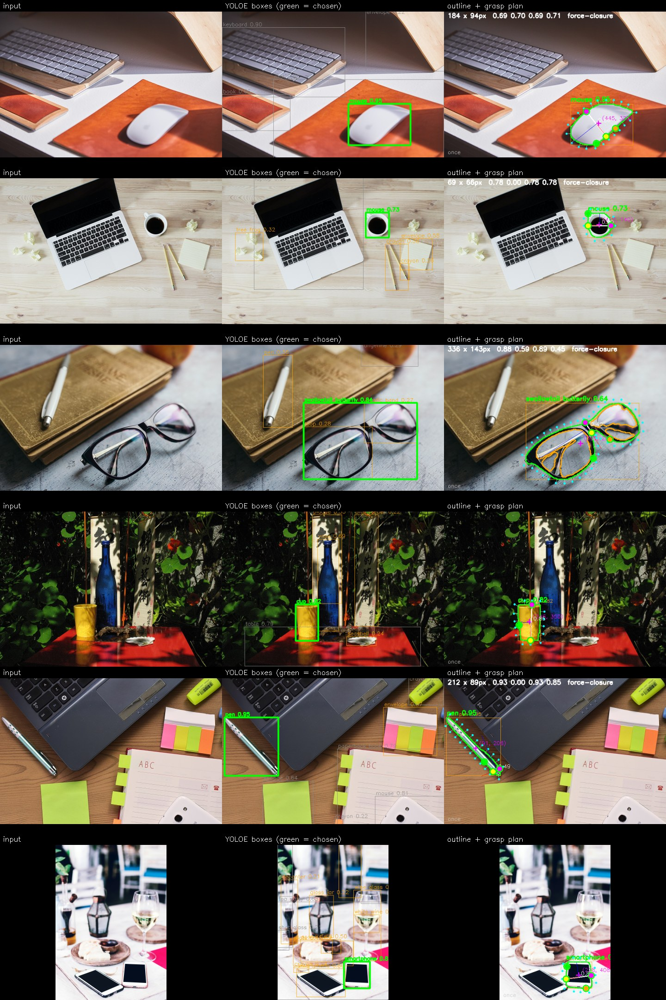
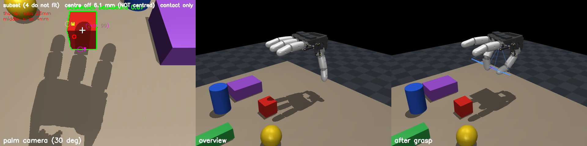
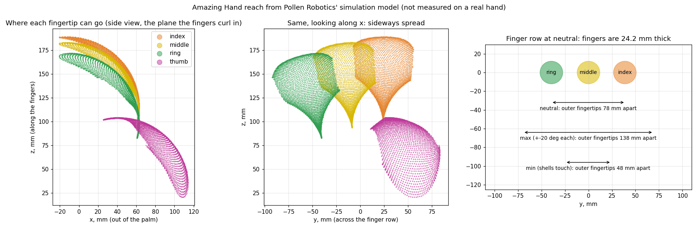
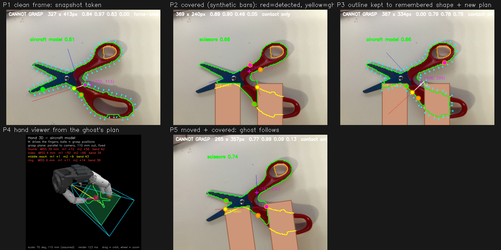
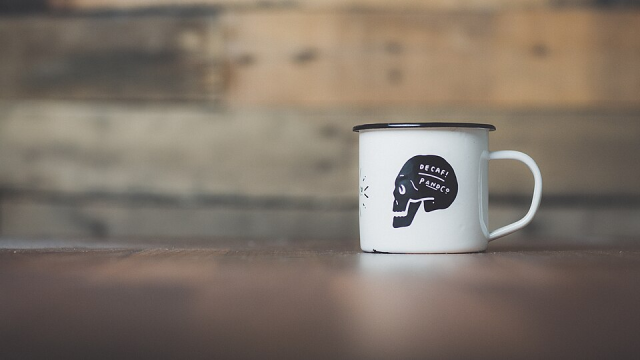
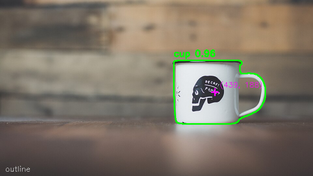
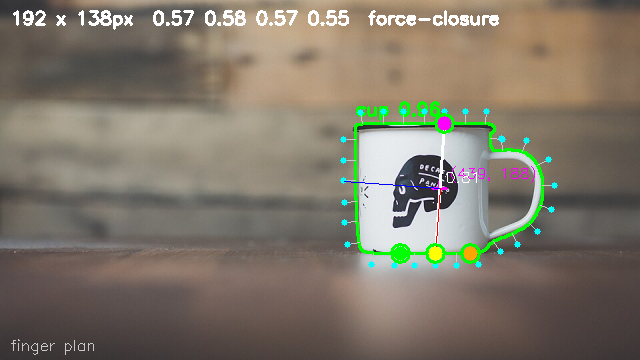

A robot hand that looks at an object, finds its outline, and places each finger against that outline so it grips the shape it is actually looking at. The target hardware is Pollen Robotics' open-source **Amazing Hand** (4 fingers, 8 servos) driven from a single-board computer with a USB webcam.

## How it works

```
USB webcam  →  vision (find object, trace outline)  →  grasp planner  →  USB serial  →  8 servos
```

1. **Find the object.** YOLOE, a prompt-free detector with a vocabulary of about 4,500 words, boxes and names the object.
2. **Trace its outline.** An edge detector runs *inside that box only* (GrabCut seeded from YOLOE's own mask, later a direct mask method), so background clutter is ignored. Holes are kept: a donut's middle, a mug handle's loop, the finger loops of a pair of scissors.
3. **Plan the grasp.** The planner picks contact points on the outline where a fingertip fits, scores pairs by force closure, and converts them to finger closures through the hand's inverse kinematics.
4. **Drive the fingers.** Positions are smoothed so the grasp stays steady, then sent over the servo bus. Everything runs as a dry run unless the real hand is explicitly connected.



*The pipeline's own output on real photos, saved unedited. Green is the object outline, orange is an inside edge (a hole), dots are where a fingertip fits.*

## Simulation

The hand and a palm camera are simulated in MuJoCo using Pollen's own model, so the vision and planner can be developed before the hardware is ready. The camera field of view is matched to the real Arducam B0332 (70° horizontal, 1280 × 800).



## Kinematics

Finger size, spread and reach were measured and used to build a workspace map, so the planner only asks the fingers for contacts they can physically reach.



## Object permanence

When the hand covers an object, the outline disappears. A tracker keeps the last good outline so the grasp stays steady while the fingers close.



## From one picture to a grasp plan

One trial on a cup: the camera picture, the outline found inside the detector's box, and the planned contact points for the thumb and fingers.





## Grasping from the app

The plan is worked out on every picture, but the fingers never move on their own. Pressing Space saves the grasp worked out at that moment and moves the fingers to it. After 1 second of holding, the servos close at a set rate to finish the grasp. While Space is held the detector takes no new pictures, so the hand keeps to the one saved grasp. Letting go goes back to live pictures. This has only been run against the simulated hand, in a dry run.

## Where it stands

- The vision pipeline, planner and kinematics are working, with an automated test suite on synthetic shapes.
- **Nothing has been tried on a real hand.** The hands are on order and the driver for them has never been run on hardware.
- **No grasp lifts an object in the simulation yet.** The simulation shows the pipeline running end to end, not a successful pick-up.
- Every design decision, measurement and failure is logged in numbered entries in the project's `DECISIONS.md`, including the approaches that did not work.

**Source:** [github.com/BeEl487/RobotHand](https://github.com/BeEl487/RobotHand)
