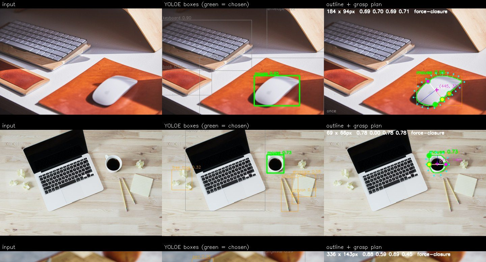
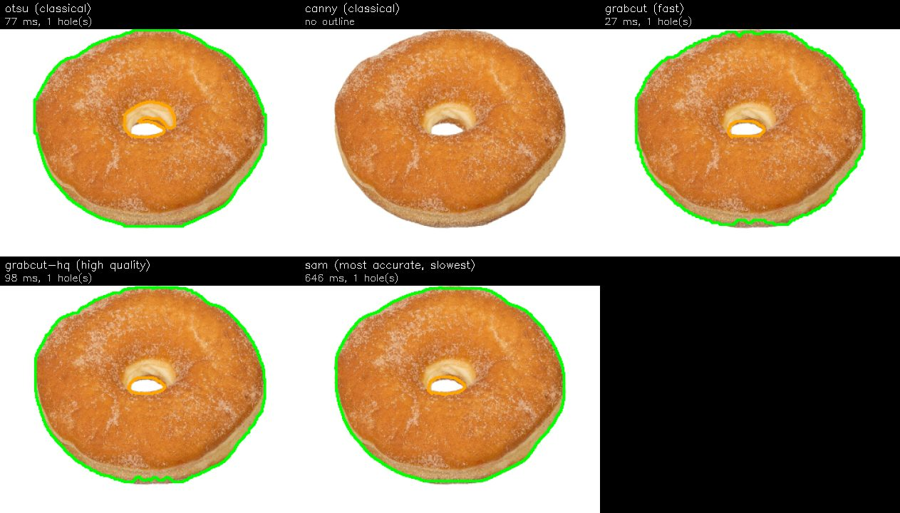
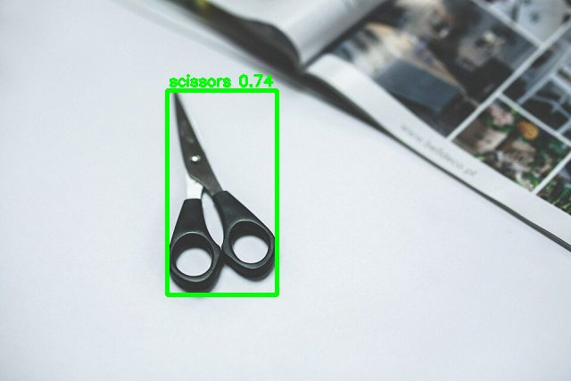
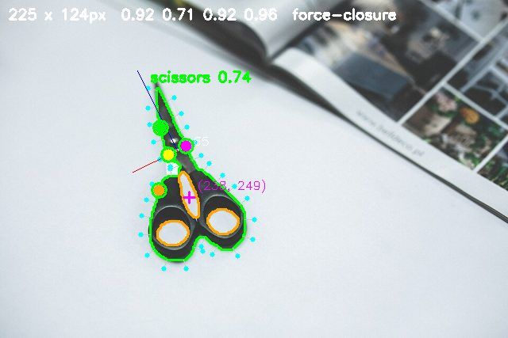

# Vision-guided robot hand

A hand that looks at an object, traces its outline, and places each finger against it. It grips the shape it actually sees.

**My role**

* Designed the whole pipeline: detection, outline, grasp planner, finger kinematics.
* Built the MuJoCo simulation and the desktop app.
* Wrote the tests and the decision log.

<ul class="glance"><li><b>4</b>fingers, 8 servos</li><li><b>~4,500</b>object names YOLOE knows</li><li><b>2</b>grasp planners</li><li><b>Dry run</b>no real hand yet</li></ul>

## How it works

Four short steps from camera to fingers.

1. **Find the object.** YOLOE draws a box around it and names it.
2. **Trace the outline.** An edge detector runs inside that box only, so the background is ignored.
3. **Plan the grasp.** Contact points are scored for force closure, then turned into finger angles.
4. **Move the fingers.** Positions are smoothed so the grasp stays steady.

<figure class="fig"><figcaption>The pipeline run on real photos (three of 22 shown). Green is the outline, orange is a hole, dots are fingertip contacts.</figcaption></figure>

## From one picture to a plan

One test on a cup. The camera picture goes in, a grasp plan comes out.

<figure><figcaption>1. The camera picture</figcaption></figure><figure><figcaption>2. The outline found inside the box</figcaption></figure><figure><figcaption>3. Planned thumb and finger contacts</figcaption></figure>

## Holes and awkward shapes

Holes are kept. A donut's middle, a mug handle and scissors' finger loops all count as edges the fingers can use.

<figure><figcaption>Edge methods compared on a doughnut</figcaption></figure><figure><figcaption>Scissors: every box the detector finds</figcaption></figure><figure><figcaption>Scissors: the finger plan</figcaption></figure>

## Keeping hold when the hand covers the object

When the hand covers the object, the outline disappears. A tracker keeps the last good outline so the grasp stays steady.

<figure class="fig"><figcaption>Scissors tracked as the hand covers them, left to right.</figcaption></figure>

## Simulation

The hand and a palm camera run in MuJoCo using Pollen Robotics' model. The camera matches the real Arducam (70 degrees, 1280 x 800).

<figure><figcaption>The vision plan drives the simulated fingers</figcaption></figure><figure><figcaption>Where the fingers can reach</figcaption></figure>

## Using it

The plan is worked out on every picture, but the fingers never move by themselves. Press **Space** to save the grasp and move the fingers to it. After one second the servos close to finish the grasp. Let go and it returns to live pictures. This has only been run on the simulated hand, as a dry run.

## Where it stands

* The pipeline, planner and kinematics work, with an automated test suite.
* **Not tried on a real hand yet.** The hands are on order.
* **No grasp lifts an object in simulation yet.** The simulation proves the pipeline end to end, nothing more.
* Every decision, number and failure is logged in `DECISIONS.md`.

**Source:** [github.com/BeEl487/RobotHand](https://github.com/BeEl487/RobotHand)
