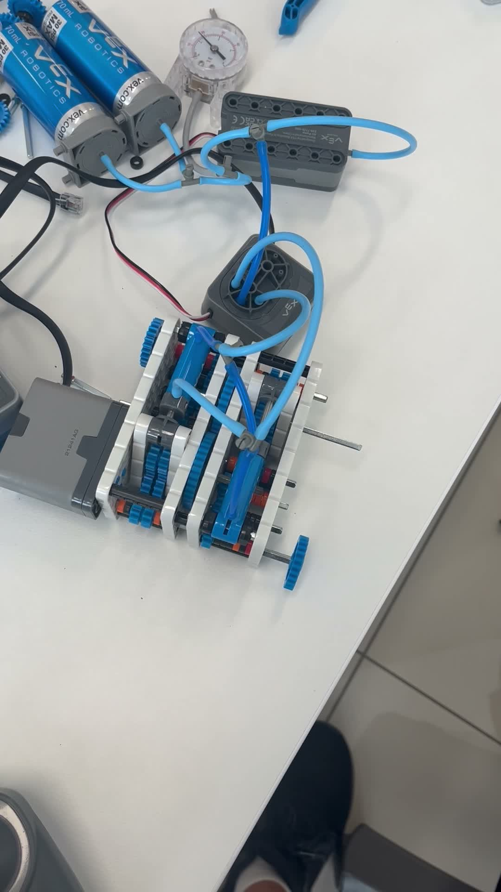
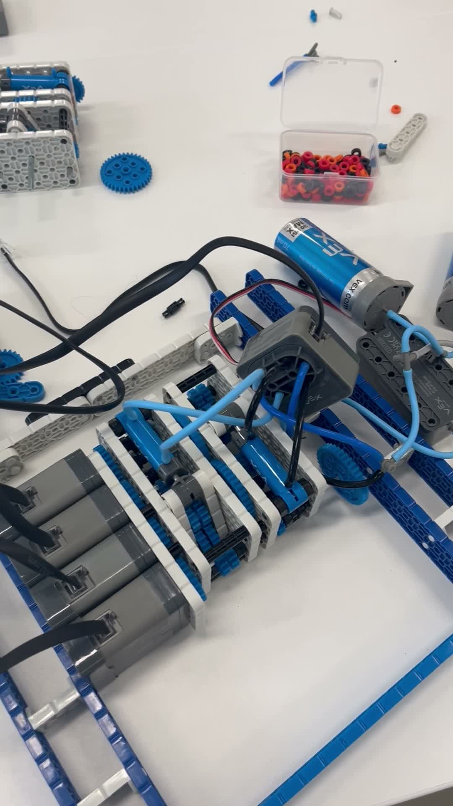
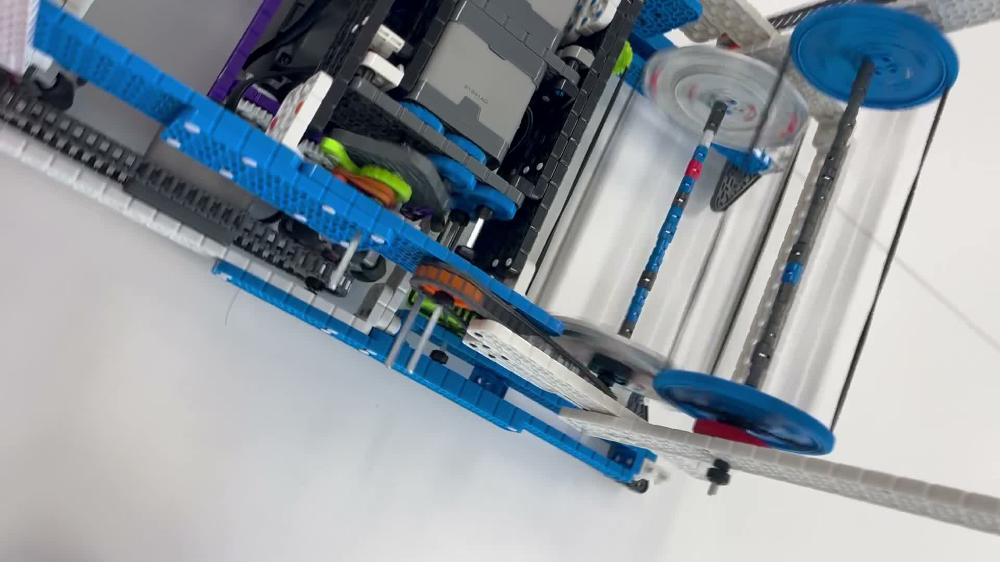
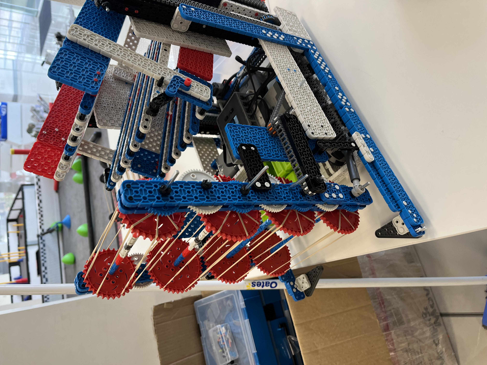

My first competitive robotics, with **4613B Barker Redbacks** in the Full Volume season (2023-24). I was interested in power transfer from the start: one motor driving more than one mechanism.

<ul class="glance"><li><b>1st</b>Barker League tournament</li><li><b>27 / 420</b>at the 2024 World Championship</li><li><b>Top 6.4%</b>at Worlds</li><li><b>164</b>teamwork score, #61 worldwide</li></ul>

<figure><video controls preload="none" poster="images/vex-iq/skills-run-2-poster.jpg"><source src="images/vex-iq/skills-run-2.mp4" type="video/mp4" /></video><figcaption>Our robot skills run at Worlds</figcaption></figure>

# Power transfer

I built several pneumatic power take-off (PTO) systems on VEX IQ parts. One motor could drive more than one mechanism without extra weight.

<figure><video controls preload="none" poster="images/vex-iq/pto/pneumatic-pto-detail-poster.jpg"><source src="images/vex-iq/pto/pneumatic-pto-detail.mp4" type="video/mp4" /></video><figcaption>A pneumatic cylinder engaging the drive</figcaption></figure><figure><video controls preload="none" poster="images/vex-iq/pto/pto-system-whole-poster.jpg"><source src="images/vex-iq/pto/pto-system-whole.mp4" type="video/mp4" /></video><figcaption>The complete PTO gearbox</figcaption></figure><figure><video controls preload="none" poster="images/vex-iq/pto/ratchet-system-spinning-poster.jpg"><source src="images/vex-iq/pto/ratchet-system-spinning.mp4" type="video/mp4" /></video><figcaption>A ratchet version under load</figcaption></figure>

<figure><figcaption>Cylinder and gear train</figcaption></figure><figure><figcaption>Parts before assembly</figcaption></figure><figure><figcaption>Ratchet system spinning</figcaption></figure>

This idea came back years later in the gravity ratchet on Switch.

# Barker League VIQC

On 17 October 2023 we **won the tournament outright** out of 34 teams. Awards: **Teamwork Champion**, **Robot Skills Champion**, and a 90-point high score.

<figure class="fig"><figcaption>The robot at practice before the tournament.</figcaption></figure>

# 2024 VEX Robotics World Championship

4613B qualified for Worlds in Dallas, one of 420 teams in the Middle School division. We finished **27th of 420**, with a qualification average of 113.5, inside the top 6.4%. Our best teamwork score was 164, **#61 worldwide**.

<figure><video controls preload="none" poster="images/vex-iq/scoring-poster.jpg"><source src="images/vex-iq/scoring.mp4" type="video/mp4" /></video><figcaption>A scoring run, showing the cycle time behind our average</figcaption></figure><figure><video controls preload="none" poster="images/vex-iq/stacking-demo-poster.jpg"><source src="images/vex-iq/stacking-demo.mp4" type="video/mp4" /></video><figcaption>A stacking demo testing precision</figcaption></figure><figure><video controls preload="none" poster="images/vex-iq/worlds-match-poster.jpg"><source src="images/vex-iq/worlds-match.mp4" type="video/mp4" /></video><figcaption>A practice match with our alliance partners</figcaption></figure>

