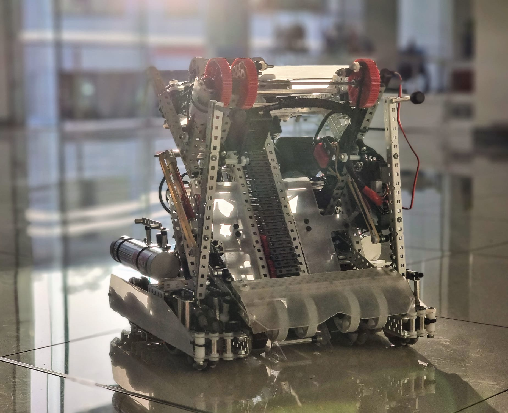
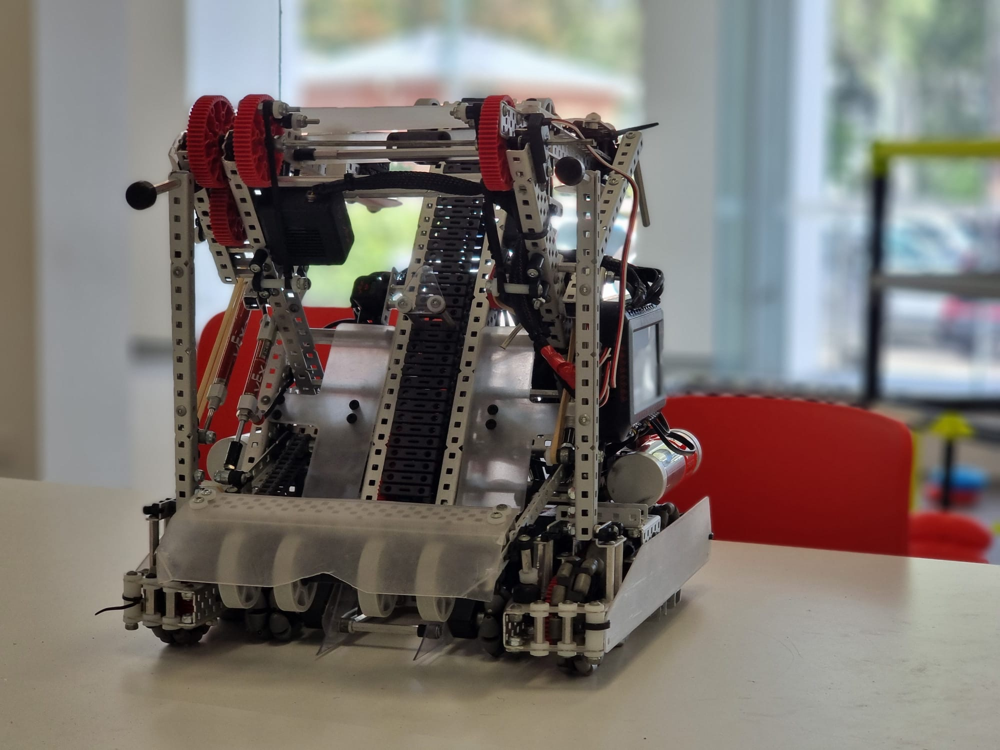
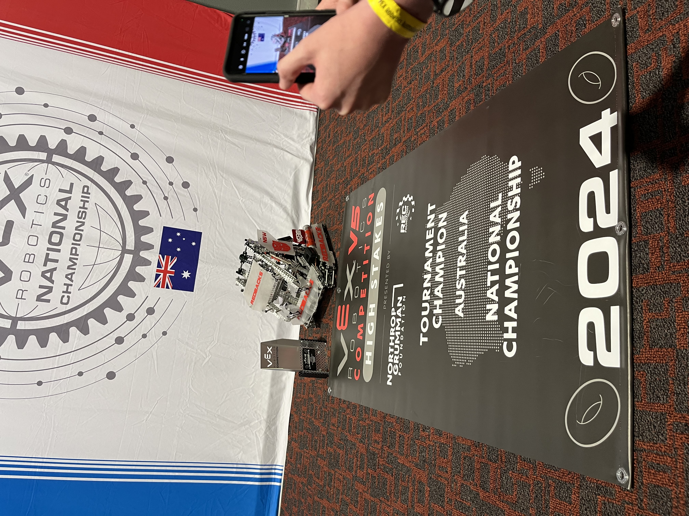

# VEX Robotics: Team 4613B (Barker College)

**Name:** Brandon Lai  
**Team:** 4613B - Barker Redbacks  
**Robot:** Whisper  
**Season:** VEX HIGH STAKES (2023–2024)

## Personal Motivation

Coming from VEX IQ, I wanted to take the next step into a more demanding robotics environment where I could apply what I had learned to larger, more complex systems. Joining VEX Robotics gave me the opportunity to move beyond building and programming within a simpler platform and start working with more advanced mechanical design, autonomous systems, CAD, and competition-driven engineering.

What interested me most was the iterative nature of competitive robotics. A design might work in testing but fail under match conditions, meaning every subsystem had to be designed, tested, measured, and refined. I wanted to understand not just how to build a robot, but how to engineer one that could perform reliably under pressure.

## Contributions/Roles

- **Team Captain**
- **Lead Designer** 
- **Lead Programmer** 

## Competition Results

- **Australian Nationals - Winner**
- **VEX Worlds Alliance Captain - 13th in Division**

## Engineering Documentation

The robot was developed through continuous design, testing, and iteration. The engineering notebook documents the design decisions, failed prototypes, testing results, CAD development, and reasoning behind the final systems.

The engineering notebook provides a more in-depth overview of the robot and the engineering process behind it.

[2024 High Stakes Nationals Notebook.pdf](https://github.com/user-attachments/files/31305593/2024.High.Stakes.Nationals.Notebook.pdf)

---

# V5RC - Middle School

## Barker Redbacks MS

As part of the same Barker Redbacks program, 4613B also competed in the **V5RC Middle School** division - moving from VEX IQ’s plastic platform onto full VEX V5 metal hardware.

### Nationals

The team competed at Nationals, running pit setup, qualification matches, and autonomous routines with the V5 robot, and won the event.

---

# V5RC - Middle School Worlds

## Barker Redbacks MS

Following the Nationals win, the team advanced to the World Championship with the V5 robot.

### My Role

* **Team Captain**

### Contributions

* [Insert]

### Event Results

| Statistic | Result |
| --- | ---: |
| Qualification Rank | [Insert] |
| Qualification Record | [Insert] |
| Alliance | [Insert] |
| Alliance Selection | [Insert] |
| Result | [Insert] |

---

# VEX Robotics Personal Portfolio: Team 4613O (Barker College)
**Name:** Brandon Lai
**Team:** 4613O (Barker College)  
**Robot:** Switch
**Season:** VEX OVERRIDE (2025–2026)  

---

## Personal Motivation

Joining VEX Robotics Team 4613O was driven by a desire to take on complex mechanical and software challenges under tight, high-stakes constraints. Rather than focusing purely on theoretical engineering, I wanted to build a high-performance system from the ground up - one where every gram of structure, millisecond of cycle time, and line of code directly impacted our competition standing. 

The 2025–2026 VEX OVERRIDE season brought strict power limits and restrictive possession rules, making it the ideal stage to test creative mechanical design, advanced software architectures, and rigorous testing methodologies. Beyond the tech, I wanted to experience true team iteration: pushing past initial design failures, refining solutions, and delivering a reliable machine under pressure.

---

## Overview of Contributions

* **Powertrain & Power Sharing:** Engineered the robot’s custom 55W powertrain layout and developed a passive Dual Gravity Ratchet Transmission (PTO). This allowed us to dynamically route motor power between the intake and lift without the weight or complexity of active pneumatic shifters.
* **Structural Engineering & CAD:** Redesigned stock structural components into custom, weight-reduced L-profiles to lower total robot mass and lower the center of gravity while keeping high-impact stress points well below material yield thresholds.
* **Autonomous & Control Systems:** Built the full autonomous navigation pipeline from scratch. Integrated Adaptive Monte Carlo Localisation (AMCL) with an IMU, distance sensors, and dual-wheel odometry to eliminate drift and ensure precise, repeatable field trajectories.
* **System Testing & Calibration:** Led physical testing regimes to map pneumatic consumption curves, measure drivetrain friction, and tune closed-loop motor controllers for consistent execution across multi-match tournament days.

---

## Key Achievements

* **55W Power Optimisation:** Successfully bypassed strict motor limits through passive gravity ratchets, delivering maximum available torque to both the drive and the Double Reverse Four-Bar (DR4B) lift mechanism.
* **High-Precision Autonomous Trajectories:** Kept autonomous pose deviation under **1.4 inches** across full-field routes using custom particle-filter sensor fusion.
* **Pneumatic Efficiency:** Achieved **24 full scoring cycles** on a single air tank - exceeding match length demands by 20% while staying safely above the 35 PSI operating threshold.
* **Rapid Field Traversal:** Clocked a sub-2.3 second full-field traversal time, maximizing point output during critical scoring windows and driver-control endgames.

---

# VEX V5RC Override: The Robot (Team 4613B)

The robot as described by its code: a tank-drive robot that drives, lifts and scores under driver control, runs a selectable autonomous, and has its own localization library.

- **Drivetrain:** six motors (three per side) on a 12 in track width with 2.75 in wheels, geared to 450 rpm for about 65 in/s.
- **Lift:** a double reverse four-bar (DR4B) raised by the **intake motors through a one-way ratchet**. That means the arm can only be driven up and falls by letting the motors spin forward. A normal PID loop would drop the arm, so the controller uses a smooth, slew-limited ramp with a hold state and four preset heights on the controller buttons.
- **Claw:** a pneumatic clamp with two rollers. R1 intakes and stops by itself when a piece jams, L1 scores and L2 matchloads. The piston is only written when it changes, so it does not waste air.
- **Side pistons:** two independent pneumatic pistons on the D-pad.
- **Sensing:** forward and sideways tracking wheels, an IMU for heading and four distance sensors for field position.
- **Software:** LemLib handles PID driving and turning, an LCD selector picks the autonomous routine, and a background task keeps the lift and claw running while the robot drives. The Monte Carlo localization library built for it is on the [Redbacks Localization](../projects/redbacks-localization.html) page.
