Two seasons of VEX Robotics. **Whisper** won the Australian Nationals. **Switch** is my most technical robot: a 55 W power-limited design with a passive gravity-ratchet transmission and its own localisation code.

# Whisper: VEX High Stakes (Team 4613B)

Whisper was our robot for the 2023-24 season, built after moving up from VEX IQ.

**My role**

* Team captain, lead designer and lead programmer.

**Results**

* **Australian Nationals winner.**
* **VEX Worlds alliance captain, 13th in division.**

<figure><figcaption>Whisper, front view</figcaption></figure><figure><figcaption>Whisper from another angle</figcaption></figure><figure>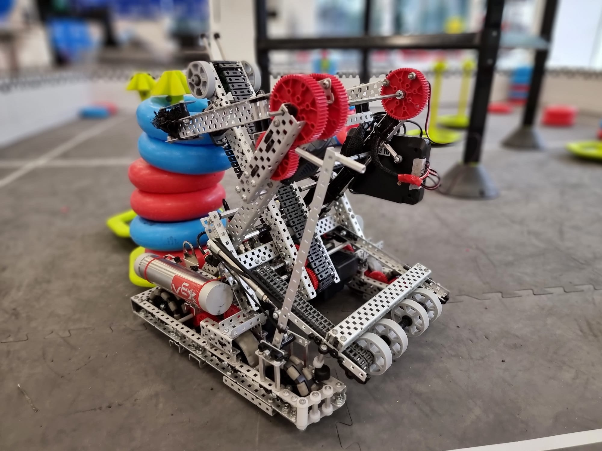<figcaption>Whisper with the ring stacks</figcaption></figure>

<figure class="fig"><figcaption>Whisper with the 2024 National Championship banner.</figcaption></figure>

The full [High Stakes Nationals notebook (PDF)](https://github.com/user-attachments/files/31305593/2024.High.Stakes.Nationals.Notebook.pdf) shows every design decision and failed prototype.

# V5RC - Middle School

The same Barker Redbacks program also entered the V5RC Middle School division, moving from VEX IQ plastic to full V5 metal. The team **won Nationals** and went on to the World Championship, with me as team captain.

<figure>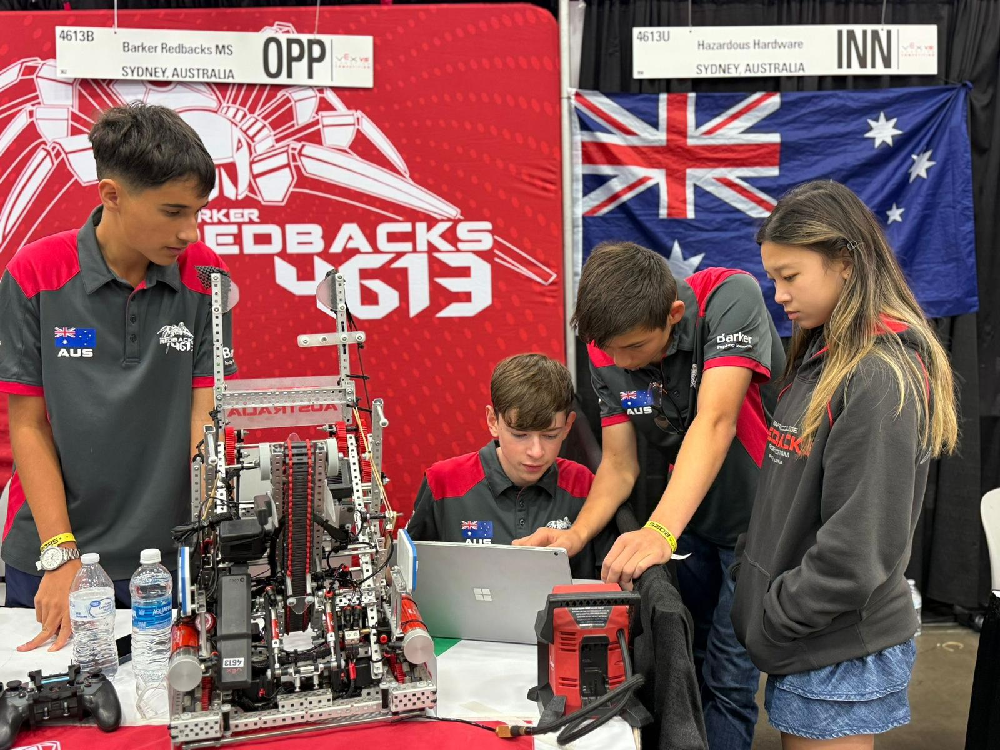<figcaption>The pit at Worlds</figcaption></figure><figure>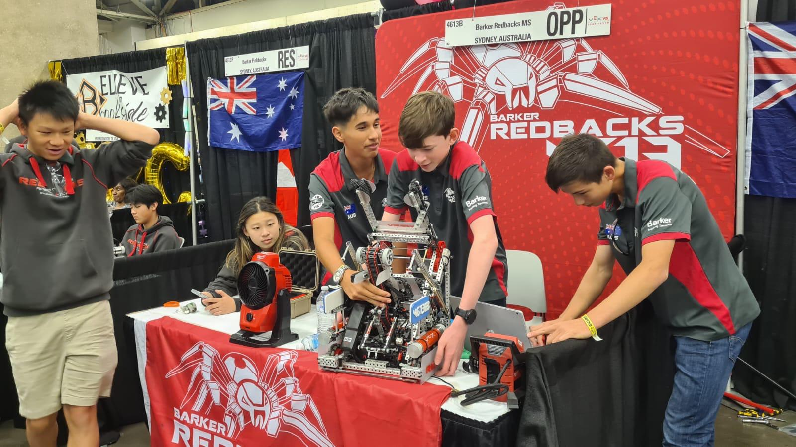<figcaption>Setting up the robot</figcaption></figure><figure>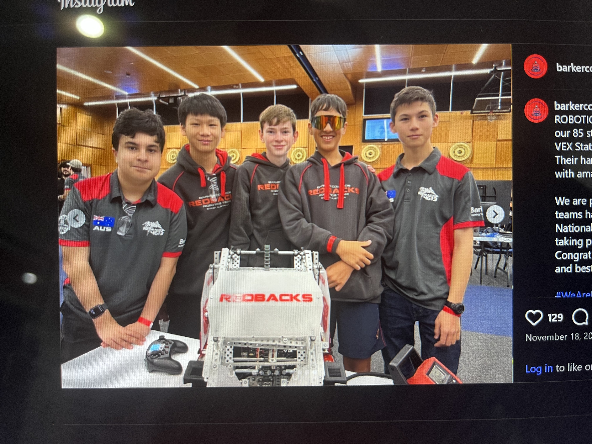<figcaption>The team</figcaption></figure>

# Switch: the robot (Override 2025-26)

Switch is the robot I designed for VEX Override, as team captain, lead designer and lead programmer. The game has strict motor limits, so the whole design is about using 55 W as well as possible.

**My role**

* Powertrain and the passive gravity-ratchet transmission.
* Full robot CAD, with lighter custom L-profile structure.
* Autonomous: odometry, distance sensors and a particle filter.
* Testing and calibration.

<ul class="glance"><li><b>55 W</b>motor power limit</li><li><b>2</b>motors drive lift and intake</li><li><b>103</b>autonomous skills best</li><li><b>< 1.4 in</b>autonomous pose error</li></ul>

<figure>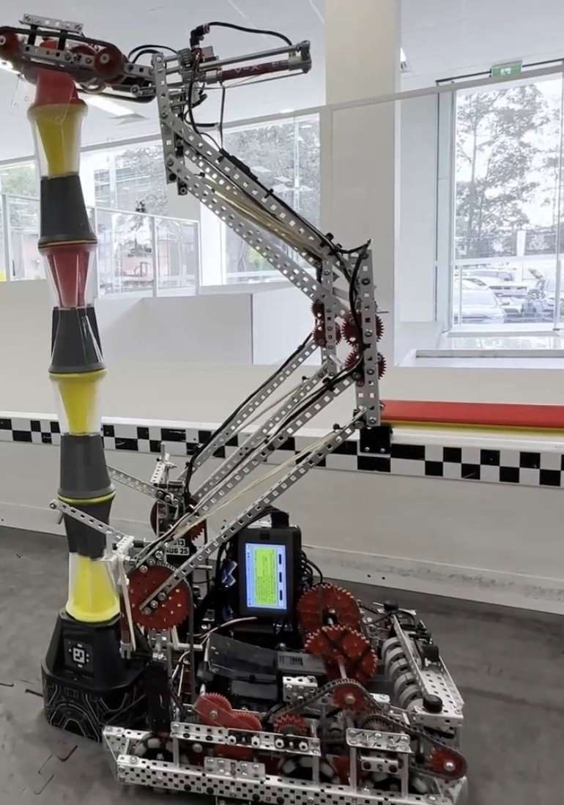<figcaption>Switch with the lift raised and a tower stacked</figcaption></figure><figure>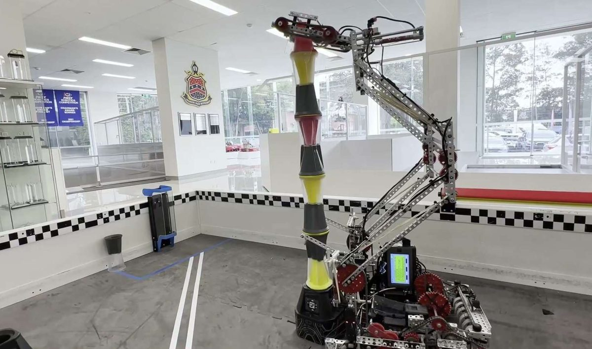<figcaption>Stacking pins and cups on a tall goal</figcaption></figure><figure>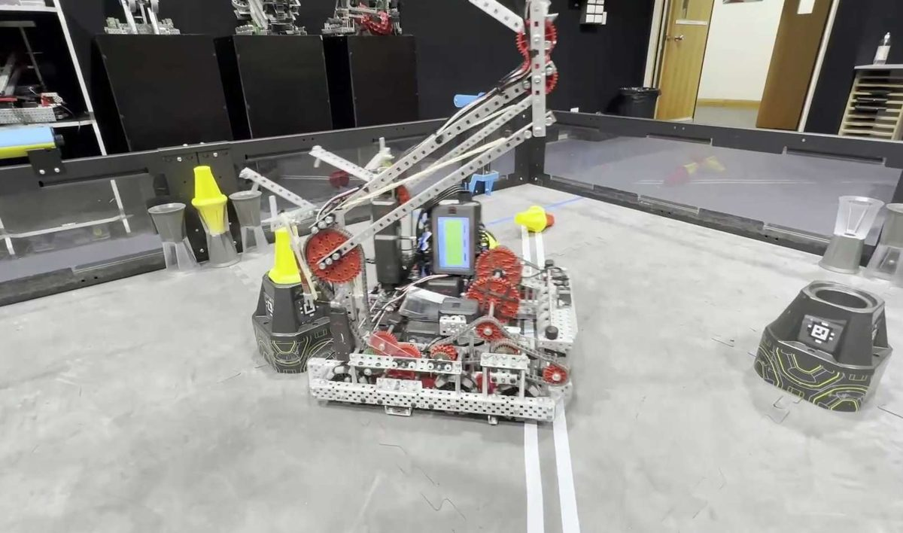<figcaption>Driving and collecting on the field</figcaption></figure>

The [robot reveal video](https://www.youtube.com/watch?v=qsefnmMplAk) (1 min 39 s) shows Switch on a full field.

# Switch: how it works

* **Drive:** six motors in tank drive, geared to 450 rpm, about 65 in/s.
* **Lift:** a double reverse four-bar (DR4B) that reaches over a tall stack.
* **One transmission, two jobs:** two motors drive both the lift and the intake through a **gravity ratchet**. Spin one way and the lift rises. Spin the other and the intake runs. The lift comes down by gravity.
* **Intake and transfer:** a pivoting front roller, a kicker roller and a transfer roller carry each piece to the end effector.
* **End effector:** two vertical rollers pull the piece in from both sides.
* **Code:** a pneumatic claw controller, a lift controller with no PID (a correction would drop the arm), and LemLib driving. See [Redbacks localization](redbacks-localization.html).

<figure>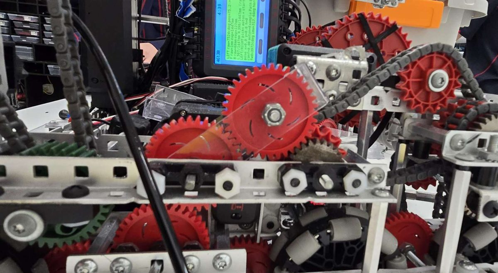<figcaption>The gravity ratchet module</figcaption></figure><figure>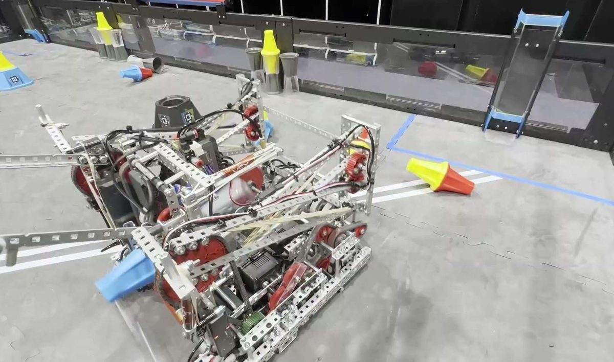<figcaption>Top view on the field</figcaption></figure><figure>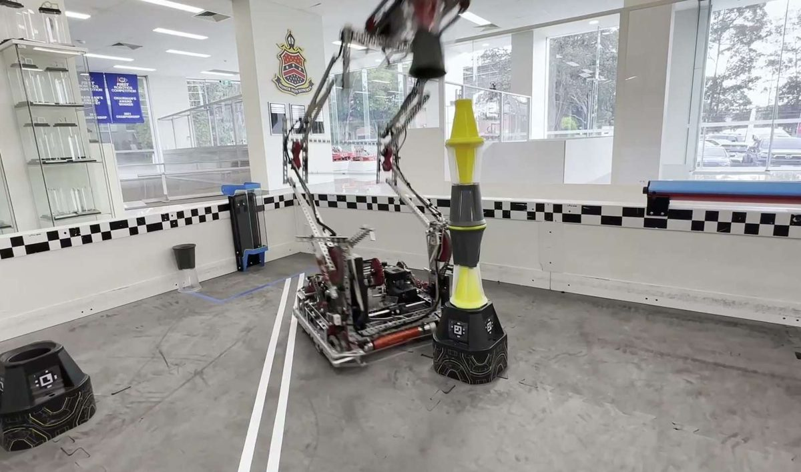<figcaption>Switch on the field</figcaption></figure>

The ratchet bolts on with eight screws, so it can be swapped quickly if it breaks.

# Switch: process

I followed the same loop for every subsystem: identify, brainstorm, pick with a scoring matrix, build, test, repeat.

* **Drivetrain:** tank drive beat H-drive, X-drive and mecanum.
* **Intake:** a hybrid pivoting roller beat horizontal and vertical rollers.
* **Lift:** a DR4B won on reach and torque.
* **End effector:** a piston claw, then a powered claw, then the final vertical rollers.

<figure>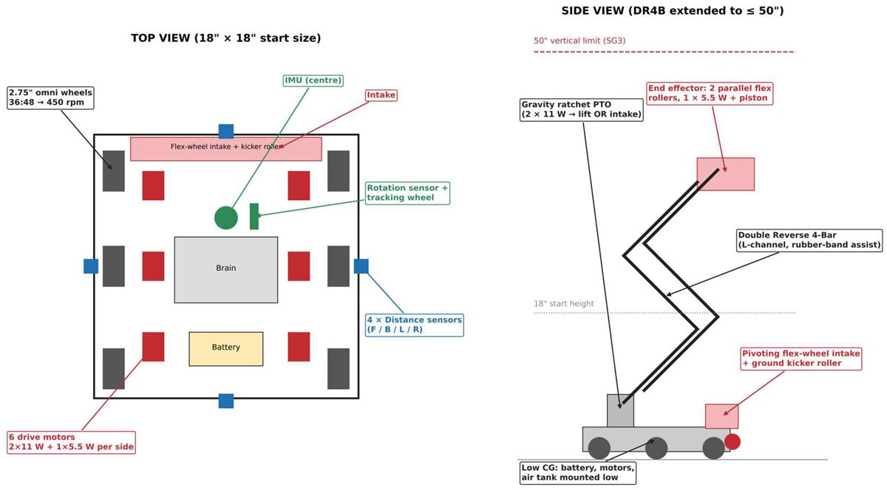<figcaption>The plan drawing the build followed</figcaption></figure><figure>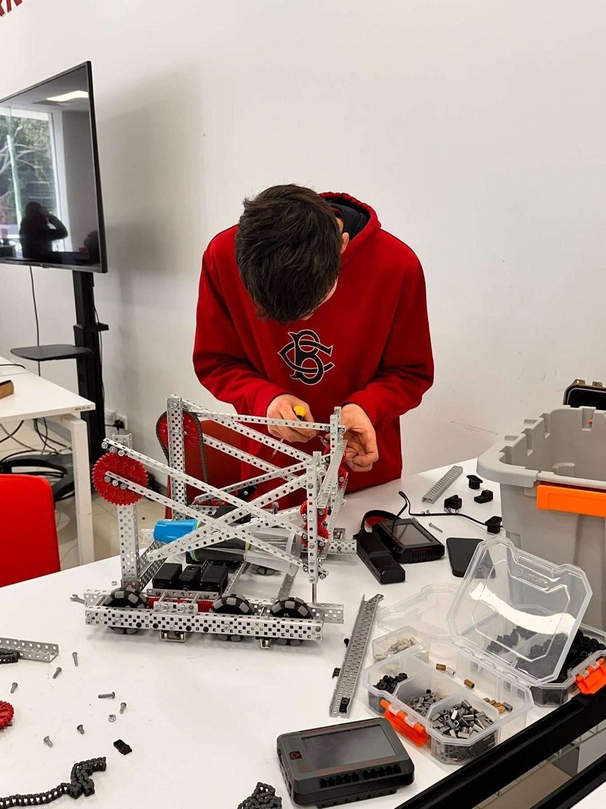<figcaption>A build session</figcaption></figure><figure>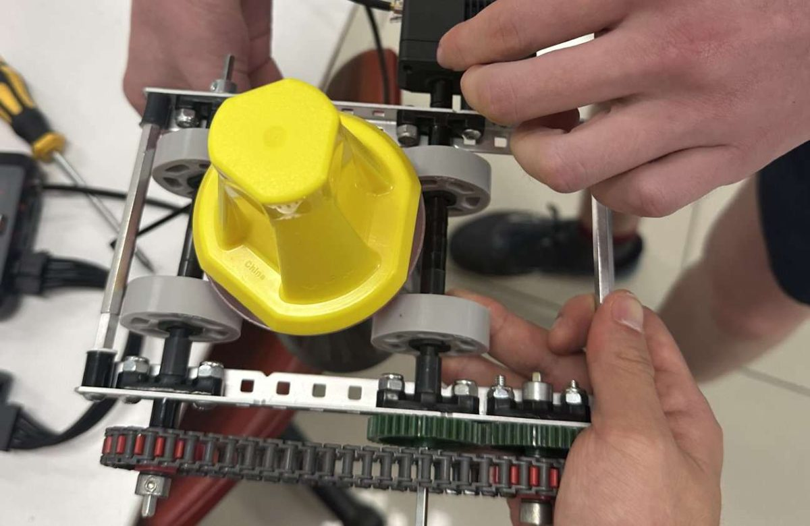<figcaption>Building the end effector</figcaption></figure>

The 194-page [engineering notebook (PDF)](../images/override/4613P-Engineering-Notebook.pdf) shows every step.

# Switch: achievements

* **55 W power optimisation:** the gravity ratchet gives full torque to both the drive and the lift within the motor limit.
* **Autonomous skills:** a planned maximum of 103 points. Best run **103**, mean of the last five runs **96**.
* **Precise autonomous:** pose error kept under 1.4 in across full-field routes with particle-filter sensor fusion.
* **Pneumatic efficiency:** 24 full scoring cycles on one air tank, 20% more than a match needs.
* **Fast:** under 2.3 seconds across the field.
* **Tested drivetrain:** straight-line drift cut from 2.3 in to 0.6 in, and turn error to 0.8 degrees.

# Switch: problems and fixes

* **Piece transfer:** pieces fell between the intake and the second roller. I moved the end effector closer and ran the kicker at about twice the intake speed. Good transfers went from 16 to 19 out of 20.
* **Picking up:** pickups rose from 8 to 19 out of 20 once a pivoting roller and a kicker roller were added.
* **Holding two pins:** a stop above the transfer cut this from 3 runs in 20 to none.
* **Lift load:** rubber bands now help the lift up. A floor-to-tall-goal lift takes 1.4 s.
* **Still open:** stacking a pin on a cup fails about one run in five. Next is a funnel on the end effector.

<figure class="fig">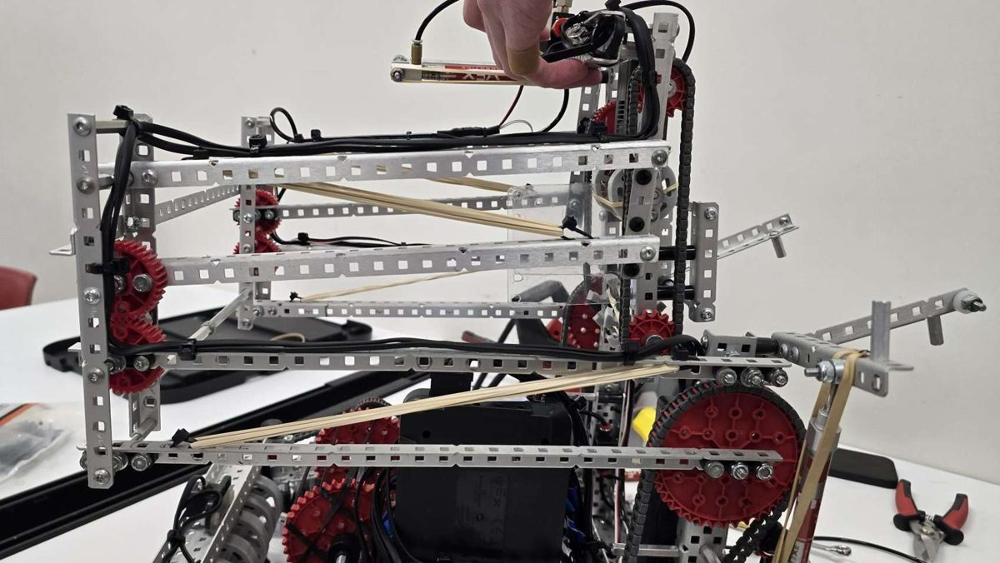<figcaption>Rubber bands across the lift links take part of the load.</figcaption></figure>
